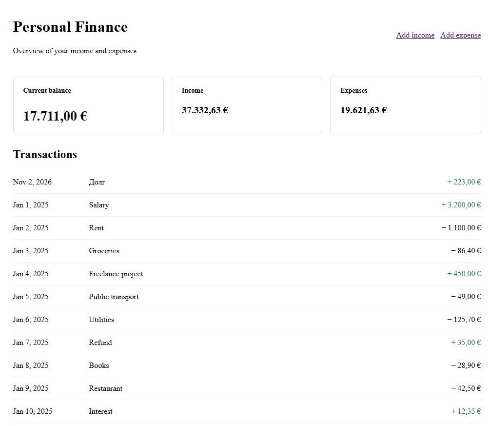
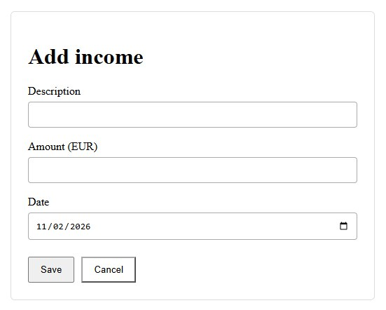
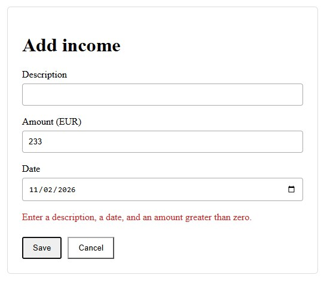
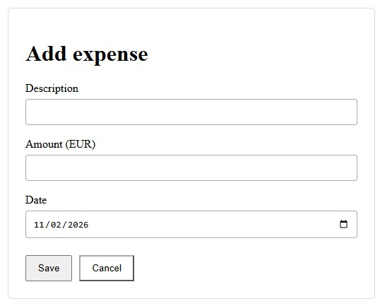
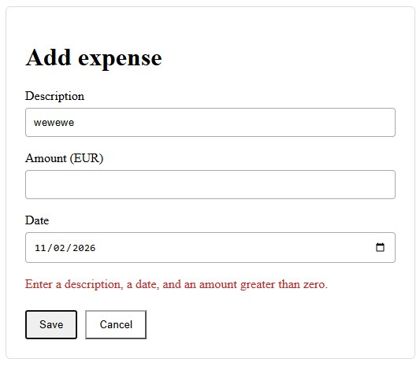
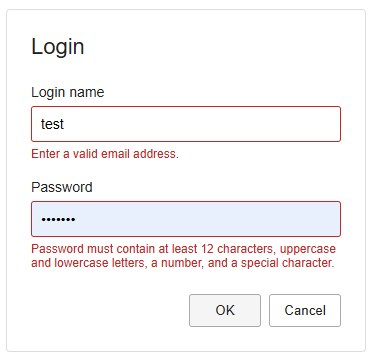
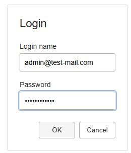

# Angular in Depth — Teil 1: Architektur und Komponenten

## 1. Architektur vor den Komponenten

Angular bietet eine strukturierte Umgebung für die Entwicklung von Frontend-Anwendungen. Dazu gehören Komponenten, Dependency Injection, reaktives State Management, HTTP-Kommunikation, Routing, Testwerkzeuge und ein umfangreiches Ökosystem von UI-Bibliotheken.

Das Vorhandensein dieser Mechanismen führt jedoch nicht automatisch zu einer guten Anwendungsarchitektur.

Ein Projekt kann Angular technisch korrekt einsetzen und trotzdem zunehmend schwer wartbar werden. Komponenten wachsen, Services sammeln unterschiedliche Aufgaben, State wird an mehreren Stellen dupliziert und Abhängigkeiten lassen sich nur noch schwer nachvollziehen. Eine neue Funktion erfordert dann Änderungen an Stellen, die eigentlich unabhängig bleiben sollten.

Diese Probleme werden nicht zwangsläufig durch Angular verursacht. Häufig entstehen sie, weil die Verantwortlichkeiten und Grenzen der Anwendung nicht klar genug definiert wurden.

Deshalb beginnen wir mit diesen Grenzen und betrachten anschließend die Angular-Mechanismen, mit denen sich Architekturentscheidungen im Code umsetzen lassen.

Ziel dieses Artikels ist es nicht, eine universelle Architektur vorzuschreiben, der jede Angular-Anwendung folgen muss. Stattdessen betrachten wir die Überlegungen hinter Architekturentscheidungen und verwenden die Anwendung Personal Finance als durchgängiges Praxisbeispiel dieser Artikelserie.

### 1.1. Architektur bedeutet Verantwortlichkeiten und Abhängigkeiten

Softwarearchitektur wird nicht durch die Anzahl der Schichten, die Verzeichnisstruktur oder die Anzahl der verwendeten Bibliotheken definiert.

Sie legt in erster Linie fest, wie ein System in Verantwortungsbereiche aufgeteilt ist und wie diese Bereiche miteinander interagieren.

Betrachten wir eine Seite, die die Ausgaben eines Benutzers darstellt. Dafür sind mehrere unterschiedliche Tätigkeiten erforderlich:

- Die Ausgabenliste anzeigen und Benutzeraktionen verarbeiten.
- Den aktuell in der Oberfläche dargestellten Zustand verwalten.
- Vorgänge wie das Laden, Erstellen oder Ändern von Ausgaben koordinieren.
- Mit dem Backend kommunizieren.
- Fehler behandeln und in verständliche Anwendungszustände überführen.
- Gemeinsame Regeln für Darstellung und Interaktion anwenden.

Diese Aufgaben hängen zusammen, stellen aber nicht dieselbe Verantwortung dar.

Wenn eine einzelne Komponente alle Aufgaben übernimmt, wird es schwierig, einen Teil der Anwendung zu ändern, ohne andere Bereiche zu beeinflussen. Eine Änderung am Backend-Vertrag kann beispielsweise Anpassungen an einer Komponente erforderlich machen, die gleichzeitig Darstellungslogik und Zustandsberechnungen enthält.

Eine Trennung der Verantwortlichkeiten macht solche Änderungen besser vorhersehbar. Außerdem entstehen klarere Ansatzpunkte für Tests, Wiederverwendung und die weitere Entwicklung der Anwendung.

Das bedeutet nicht, dass für jede Verantwortung sofort eine eigene Klasse oder Bibliothek angelegt werden muss. Eine kleine Anwendung benötigt für eine einfache Funktion möglicherweise keine mehreren Schichten. Wichtig ist, zwischen dem Verständnis der Verantwortlichkeiten und der Entscheidung über ihre strukturelle Trennung zu unterscheiden.

Architektur sollte das Verständnis und die Änderung eines Systems erleichtern und nicht lediglich zusätzliche Abstraktionen schaffen.

### 1.2. Die wichtigsten Verantwortungsbereiche einer Frontend-Anwendung

Für unsere Anwendung Personal Finance lassen sich vier übergeordnete Verantwortungsbereiche unterscheiden.

**Benutzeroberfläche**

Die UI stellt Informationen dar und ermöglicht die Interaktion mit der Anwendung. Dazu gehören Seiten, Komponenten, Templates und visuelle Elemente.

Ihre Hauptaufgabe ist die Interaktion mit dem Benutzer. Sie muss weder die Details einer HTTP-Anfrage kennen noch wissen, wie das Backend eine Finanztransaktion speichert.

**Anwendungslogik und Koordination**

Dieser Bereich koordiniert die vom Benutzer ausgelösten Vorgänge. Er legt fest, welche Aktionen ausgeführt werden müssen, wie der entsprechende Zustand aktualisiert wird und wie die Anwendung auf Erfolg oder Fehler reagiert.

Je nach Komplexität der Anwendung kann diese Verantwortung in einer Komponente, einem Service, einer Fassade oder einer Kombination daraus umgesetzt werden.

**State Management**

Die Anwendung benötigt eine konsistente Darstellung der Informationen, die für die UI aktuell relevant sind. Dazu können geladene Ausgaben, Ladeindikatoren, ausgewählte Filter und berechnete Summen gehören.

Die Architektur sollte erkennen lassen, welcher Teil der Anwendung einen bestimmten Zustand besitzt, welche Bereiche ihn lesen dürfen und wie Änderungen weitergegeben werden.

Nicht jeder Wert benötigt einen gemeinsamen State-Management-Mechanismus. Temporärer Zustand, der nur zu einer einzelnen Komponente gehört, kann häufig innerhalb dieser Komponente bleiben.

**Datenzugriff und externe Kommunikation**

Dieser Bereich ist für die Kommunikation mit dem Backend und anderen externen Systemen zuständig. Dazu gehören HTTP-Anfragen, die Verarbeitung von Antworten und technische Details des API-Vertrags.

Werden diese Aufgaben von der Darstellung getrennt, kann sich die Benutzeroberfläche weiterentwickeln, ohne zu eng an die Transportschicht gekoppelt zu sein.

Diese vier Bereiche sind ein konzeptionelles Modell und keine verpflichtende Architektur mit vier Schichten. Sie helfen uns, über Verantwortlichkeiten nachzudenken. In einem realen Projekt können einige Bereiche zusammengefasst werden, während andere eine weitere Aufteilung benötigen.

### 1.3. Den Datenfluss durch die Anwendung verfolgen

Eine hilfreiche Methode zur Bewertung einer Architektur besteht darin, den vollständigen Weg eines Vorgangs von der UI zum Backend und zurück nachzuverfolgen.

Nehmen wir an, ein Benutzer öffnet die Ausgabenseite in Personal Finance.

1. Die Seite startet einen Ladevorgang.
2. Die Anwendung koordiniert die Anfrage und stellt den aktuellen Ladezustand bereit.
3. Der Data-Access-Service sendet eine HTTP-Anfrage an das Backend.
4. Die Antwort kommt zurück und wird verarbeitet.
5. Der Anwendungszustand wird aktualisiert.
6. Die UI reagiert auf den neuen Zustand und zeigt die Ausgaben an.

Schlägt die Anfrage fehl, folgt die Anwendung einem alternativen Ablauf: Sie erfasst oder veröffentlicht den entsprechenden Fehlerzustand, beendet den Ladevorgang und ermöglicht der UI, eine passende Meldung anzuzeigen.

Die konkrete Implementierung kann unterschiedlich aussehen. Für eine einfache Funktion reichen möglicherweise eine Komponente und ein Service. Eine komplexere Funktion kann von einer Fassade und einem eigenen State-Service profitieren.

Entscheidend ist, dass der Datenfluss verständlich bleibt.

Eine Komponente muss nicht wissen, wie eine HTTP-Anfrage aufgebaut wird. Ein Data-Access-Service sollte nicht entscheiden, wie eine bestimmte Fehlermeldung dargestellt wird. Berechnete Werte wie die Gesamtausgaben sollten nicht unnötig als unabhängig gepflegter Zustand dupliziert werden.

Werden diese Verantwortlichkeiten vermischt, lässt sich der Datenfluss schwerer nachvollziehen. Sind sie klar definiert, ist leichter zu erkennen, wo eine Änderung hingehört und wie sich ihre Auswirkungen überprüfen lassen.

### 1.4. Grenzen sollten Verantwortlichkeiten und Änderungsgründe widerspiegeln

Eine sinnvolle Architekturgrenze trennt Verantwortlichkeiten, die sich voraussichtlich aus unterschiedlichen Gründen ändern werden.

Die visuelle Darstellung der Ausgabenseite kann sich beispielsweise durch eine Aktualisierung des Designsystems ändern. Der Backend-Vertrag kann sich mit der Weiterentwicklung der API verändern. Die Regeln zur Berechnung der Finanzübersicht können aufgrund neuer fachlicher Anforderungen angepasst werden.

Sind all diese Aufgaben eng miteinander gekoppelt, birgt jede Änderung unnötige Risiken für die übrigen Teile der Anwendung.

Eine Trennung beseitigt nicht sämtliche Abhängigkeiten. Die UI benötigt weiterhin Daten, die Anwendungslogik muss mit externen Systemen kommunizieren und der Zustand muss die Ergebnisse der Vorgänge widerspiegeln.

Das Ziel besteht darin, Abhängigkeiten explizit zu machen und auf das tatsächlich notwendige Maß zu begrenzen.

Deshalb sollte eine gemeinsame UI-Komponente nicht automatisch von einem API-Service einer bestimmten Fachfunktion abhängen. Aus demselben Grund sollte ein Data-Access-Service nicht von der visuellen Komponente abhängig sein, die seine Ergebnisse verwendet.

Die Richtung der Abhängigkeiten ist wichtig: Sie beeinflusst, wie einfach einzelne Teile der Anwendung wiederverwendet, getestet oder ersetzt werden können.

### 1.5. Unter- und Überarchitektur vermeiden

Bei der Gestaltung einer Frontend-Architektur treten häufig zwei gegensätzliche Fehler auf.

Der erste besteht darin, Architekturentscheidungen so lange aufzuschieben, bis die Anwendung schwer wartbar geworden ist. Komponenten sammeln nach und nach unterschiedliche Aufgaben an, Services werden zu universellen Sammelstellen und gemeinsamer State wird eingeführt, ohne klar zu definieren, wem er gehört.

Der zweite Fehler besteht darin, eine komplexe Architektur aufzubauen, bevor die Anforderungen der Anwendung sie rechtfertigen. Jede Komponente erhält eine Fassade, jeder Vorgang einen eigenen Service und selbst einfache Interaktionen müssen mehrere Schichten durchlaufen.

Beide Extreme sind nicht wünschenswert.

Besser ist es, Verantwortlichkeiten von Anfang an zu definieren und zusätzliche Grenzen dann einzuführen, wenn sie ein konkretes Problem lösen.

Ein eigener Service kann sinnvoll sein, wenn Funktionalität wiederverwendet, unabhängig getestet oder von der UI getrennt werden muss. Eine Fassade kann hilfreich sein, wenn mehrere Komponenten eine einheitliche Schnittstelle für Vorgänge und Anwendungszustand benötigen. Eine separate NX-Bibliothek kann sinnvoll werden, wenn eine tatsächliche funktionale Grenze oder ein Wiederverwendungsbedarf entsteht.

Diese Entscheidungen sollten sich aus den Anforderungen der Anwendung ergeben und nicht aus dem Wunsch, eine vorgegebene Verzeichnisstruktur nachzubilden.

Die entscheidende Frage ist nicht, ob die Architektur genügend Schichten besitzt. Entscheidend ist, ob ihre Grenzen das Verständnis, Testen und Ändern des Systems erleichtern.

### 1.6. Wie Angular und NX Architekturentscheidungen unterstützen

Angular stellt Mechanismen bereit, mit denen sich Anwendungsgrenzen ausdrücken lassen.

Komponenten kapseln Teile der Benutzeroberfläche. Dependency Injection macht Abhängigkeiten explizit und ermöglicht Angular, die Erzeugung und Konfiguration von Objekten zu verwalten. Services bieten einen Ort für Funktionalität, die nicht an eine bestimmte visuelle Komponente gebunden sein sollte. Signals und RxJS bieten unterschiedliche Ansätze zur Darstellung von Zustand und zur Verarbeitung asynchroner Vorgänge.

Diese Mechanismen sind hilfreich, weil sie Architekturentscheidungen unterstützen. Sie treffen diese Entscheidungen jedoch nicht automatisch.

Wenn eine Anwendung wächst und mehrere Projekte und Bibliotheken umfasst, bietet NX zusätzliche Möglichkeiten. Der Code lässt sich in separate Projekte organisieren und Abhängigkeiten zwischen ihnen können eingeschränkt werden.

Das wird besonders nützlich, wenn Personal Finance nicht mehr nur aus einer Anwendung besteht, sondern wiederverwendbare UI-Elemente, Feature-Bibliotheken und separate Data-Access-Funktionalität umfasst.

Das Anlegen separater Projekte schafft allerdings nicht automatisch sinnvolle Grenzen. Eine schlecht entworfene Abhängigkeitsstruktur bleibt schlecht, auch wenn jeder Teil in einer eigenen Bibliothek liegt.

Auf diese Entscheidungen kommen wir in späteren Teilen der Serie zurück. Dort betrachten wir Dependency Injection, State Management, API-Kommunikation und die Organisation einer Angular-Anwendung innerhalb eines NX-Workspace.

Für den Moment halten wir uns an ein einfaches Prinzip: Zuerst müssen die Verantwortlichkeiten und Abhängigkeiten der Anwendung verstanden werden. Anschließend nutzen wir Angular und NX, um die tatsächlich sinnvollen Grenzen auszudrücken und durchzusetzen.

### 1.7. Workspace-Struktur: Wo der Code liegt und warum

Nun übertragen wir die Architekturgrenzen auf die Struktur des NX-Workspace. Ein Verzeichnis allein macht Code weder wiederverwendbar noch unabhängig. Jedes Projekt und jeder Ordner benötigt eine klare Verantwortung, und die Richtung der Abhängigkeiten muss kontrollierbar bleiben.

Unser Lern-Workspace verwendet vier Hauptbereiche:

- `apps` — Einstiegspunkte und Build-Konfigurationen der Anwendungen.
- `libs` — Bibliotheken mit Funktionalität und Verträgen, nach Verantwortlichkeiten getrennt.
- `common` — Ressourcen und Konfigurationen, die von Anwendungen gemeinsam genutzt werden, aber keine eigenständige Business-Logic-Bibliothek darstellen.
- Konfigurationsdateien im Root — workspaceweite Regeln und Einstellungen für NX, TypeScript, ESLint, Formatierung und Entwicklungstools.

#### Die Anwendung als Composition Root

`apps/personal-finance` enthält die anwendungsspezifische Konfiguration: Bootstrap, übergeordnete Routes, Provider, Root-Komponente und Build-Einstellungen. Die Anwendung setzt die benötigten Bibliotheken zusammen und verbindet sie zu einem lauffähigen System.

Die Anwendung sollte nicht zum Speicherort sämtlicher Funktionalität werden. Seiten, wiederverwendbare Komponenten, Verträge und Daten haben jeweils eigene Verantwortungsbereiche.

#### Feature-Bibliotheken

`libs/personal-finance/pages` enthält Seiten und Komponenten, die ausschließlich zu Personal Finance gehören:

```text
libs/personal-finance/pages/
└── src/
    ├── index.ts
    └── lib/
        ├── components/
        │   └── login/
        ├── state/
        │   └── transaction.store.ts
        └── views/
            ├── dashboard/
            ├── login/
            └── transaction-form/
```

Der Ordner `views` ist für Seiten vorgesehen, die am Routing teilnehmen. `components` enthält zusammengesetzte UI-Komponenten, die von diesen Seiten verwendet werden. `state` enthält Zustand, dessen Geltungsbereich derzeit auf diese Bibliothek beschränkt ist.

Wir legen keinen verschachtelten Pfad wie `pages/src/lib/pages` an: Der Bibliotheksname beschreibt die Verantwortung bereits. Ihn auf jeder Ebene zu wiederholen, bringt keinen Mehrwert.

In dieser kleinen Lernanwendung bleibt `TransactionStore` zunächst bei den Seiten, weil seine Verbraucher und sein Geltungsbereich auf diese Feature-Bibliothek beschränkt sind. Das ist eine bewusste Vereinfachung und keine allgemeingültige Regel. Wenn State und Anwendungsoperationen von mehreren Bibliotheken benötigt werden oder eine eigenständige funktionale Grenze bilden, können sie beispielsweise nach `libs/personal-finance/facades` verschoben werden. Ein Feature-spezifischer Store gehört nicht automatisch nach `libs/shared/facades`: Shared ist für tatsächlich gemeinsam genutzte Fähigkeiten vorgesehen und nicht für Code, der lediglich von mehreren Komponenten einer Anwendung verwendet wird.

#### Shared Libraries

`libs/shared` enthält Code, der nicht ausschließlich zu Personal Finance gehört und von anderen Anwendungen oder Feature-Bibliotheken verwendet werden kann.

| Bibliothek | Verantwortung |
|---|---|
| `shared/definitions` | Gemeinsame Verträge und Definitionen: Interfaces, Types, Enums, Constants, Classes, Abstracts und Records |
| `shared/ui` | Wiederverwendbare UI-Komponenten, Direktiven und Pipes |
| `shared/base` | Gemeinsame Basisfunktionalität, sofern sie tatsächlich von mehreren Systemteilen benötigt wird |
| `shared/facades` | Gemeinsame Fassaden zur Koordination geteilter Funktionalität |
| `shared/dal` | Gemeinsame Data-Access-Infrastruktur ohne Abhängigkeit von einem bestimmten Feature |

Im aktuellen Beispiel sind `definitions` und `ui` die inhaltlich wichtigsten Bibliotheken. Die Projekte `base`, `facades` und `dal` existieren als separate Workspace-Projekte. Das bedeutet jedoch nicht, dass dort künstlich Code untergebracht werden muss. Eine Bibliothek erhält eine Implementierung, wenn eine echte Verantwortung entsteht.

Feature-spezifischer Datenzugriff sollte bei Bedarf im entsprechenden Feature-Bereich liegen, beispielsweise in `libs/personal-finance/dal`, und nicht automatisch in `libs/shared/dal`. Entscheidend sind die Verantwortung und die Möglichkeit einer unabhängigen Wiederverwendung.

#### Definitions: Nach Art statt nach Feature gruppieren

Die Definitionen in `libs/shared/definitions/src/lib` werden nach ihrer Art gruppiert:

```text
definitions/src/lib/
├── abstracts/
├── classes/
├── constants/
├── enums/
├── interfaces/
├── records/
└── types/
```

Jede Definition befindet sich in einer eigenen TypeScript-Datei. Beispiele:

- `interfaces/transaction.ts` — Vertrag einer Transaktion;
- `enums/transaction-type.enum.ts` — numerischer Transaktionstyp;
- `interfaces/login-credentials.ts` — Datenvertrag des Login-Formulars;
- `interfaces/field-validation-result.ts` — gemeinsames Validierungsergebnis;
- `constants/routes.ts` — zentralisierte Route-Werte;
- `constants/validation.regex.ts` — gemeinsame reguläre Ausdrücke.

Es sollten keine Ordner wie `models`, `utils` oder `helpers` angelegt werden, in denen unterschiedliche Arten von Definitionen vermischt werden. Die Kategorie richtet sich nach der Art der Entität und nicht nach der Seite, die sie verwendet.

Die öffentlichen Exporte werden in den Indexdateien der jeweiligen Kategorien gesammelt und über Aliase bereitgestellt. Dadurch erhält die Bibliothek eine explizite öffentliche API und Verbraucher müssen keine internen Pfade importieren.

#### Mock: Eine separate gemeinsame Bibliothek

Demodaten liegen in `libs/mock`, nicht in `libs/personal-finance` und auch nicht in einer bestimmten Feature-Bibliothek:

```text
libs/mock/
├── project.json
├── tsconfig.json
├── tsconfig.lib.json
└── src/
    ├── index.ts
    └── lib/
        └── demo-transactions.mock.ts
```

Mock-Daten können nicht nur von Personal Finance benötigt werden, sondern auch von Testszenarien, Demo-Seiten oder anderen Anwendungen. Deshalb ist die Bibliothek gemeinsam nutzbar und besitzt den Alias `@workshop:mock`.

Das bedeutet nicht, dass sämtliche Test-Fixtures aller Bibliotheken wahllos in Mock abgelegt werden sollen. Dort befinden sich gemeinsame Demo-Datensätze. Spezifische Test-Fixtures, die nur ein einzelner Test oder eine Bibliothek benötigt, können direkt neben diesem Test bleiben. Für diese Lernanwendung ist die separate Mock-Bibliothek der zentrale Ort für Daten, die als initialer Anwendungsinhalt verwendet werden.

Die Mock-Bibliothek besitzt bewusst keine eigene Testsuite und keine Vitest-Konfiguration, da sie statische Demodaten enthält. Die übrigen Bibliotheken, einschließlich `shared/definitions`, behalten ihre Testinfrastruktur.

#### Common: Gemeinsame Ressourcen und Konfiguration

Das Verzeichnis `common` ist keine weitere Business-Logic-Bibliothek. Es enthält gemeinsame Ressourcen, Styles und Konfigurationen:

```text
common/
├── assets/
├── environments/
│   ├── common.ts
│   ├── environment.dev.ts
│   ├── environment.prod.ts
│   └── environment.test.ts
└── styles/
    └── common.scss
```

Beispielsweise legt `COMMON.DEFAULT_CURRENCY` die Standardwährung fest, während `common/styles/common.scss` gemeinsame Styles enthält. Gemeinsame Assets müssen nicht in jede Anwendung kopiert werden.

#### Aliase: Öffentliche Namen der Bibliotheken

Die TypeScript-Path-Aliase werden zentral in der Root-Datei `tsconfig.base.json` definiert. Im Workspace wird ein einheitlicher Namespace verwendet: `@workshop:`.

| Alias | Zweck |
|---|---|
| `@workshop:ui` | Shared UI |
| `@workshop:mock` | Gemeinsame Mock-Daten |
| `@workshop:facades` | Shared Facades |
| `@workshop:dal` | Shared Data Access |
| `@workshop:base` | Shared Base |
| `@workshop:def:consts` | Definitions: Constants |
| `@workshop:def:abstracts` | Definitions: Abstract Classes |
| `@workshop:def:classes` | Definitions: Classes |
| `@workshop:def:enums` | Definitions: Enums |
| `@workshop:def:interfaces` | Definitions: Interfaces |
| `@workshop:def:records` | Definitions: Records |
| `@workshop:def:types` | Definitions: Types |
| `@workshop:personal-finance:pages` | Personal-Finance-Seiten |
| `@workshop:common` | Gemeinsame Anwendungskonfiguration aus `common/environments/common.ts` |

Für dieselben Bibliotheken sollten keine alternativen Kurz-Aliase wie `base`, `dal` oder `facades` hinzugefügt werden. Zwei Namen für denselben Pfad schaffen Mehrdeutigkeit und führen mit der Zeit zu unterschiedlichen Importstilen. Ein Alias ist Teil des öffentlichen Vertrags einer Bibliothek und sollte einheitlich bleiben.

#### Der Zusammenhang mit NX Boundaries

Verzeichnisse helfen Menschen bei der Orientierung im Workspace. Architekturregeln sollten jedoch durch Werkzeuge überprüft werden. Deshalb erhalten NX-Projekte Tags, und Module-Boundary-Regeln schränken zulässige Abhängigkeiten ein.

Nach unserer Konvention erhalten Bibliotheken das Level-Tag `level:shared` und ein eigenes Tag `tag:<library-name>`. Die Anwendung erhält `level:app` und `app:<app-name>`. ESLint/NX verwendet diese Tags zur Überprüfung der Abhängigkeiten. Damit wird die Regel, dass Shared-Code nicht von einer konkreten Anwendung abhängen darf, nicht nur zu einer Teamvereinbarung, sondern zu einer überprüfbaren Einschränkung.

Die Verzeichnisstruktur beantwortet die Frage „Wo finde ich den Code?“, öffentliche Aliase beantworten „Wie greife ich darauf zu?“ und NX Boundaries beantworten „Welches Projekt darf von welchem anderen Projekt abhängen?“. Das sind drei unterschiedliche Mechanismen, die sich gegenseitig ergänzen.

## 2. LoginComponent: Von der Benutzereingabe zur aktualisierten Ansicht

Als praktisches Beispiel betrachten wir das Login-Formular von Personal Finance. Die Komponente speichert die eingegebenen Werte, empfängt Validierungsergebnisse der Direktiven und informiert die übergeordnete Seite, wenn die lokale Validierung erfolgreich war.

LoginComponent und die Anwendungsseiten befinden sich in der anwendungsspezifischen Bibliothek `libs/personal-finance/pages`. Wiederverwendbare Direktiven liegen in `libs/shared/ui`.

### 2.1. Komponentenstruktur

Die Implementierung von LoginComponent ist auf drei Dateien aufgeteilt: `login.component.ts` enthält Zustand und Handler, `login.component.html` enthält Markup und Angular-Bindings und `login.component.scss` enthält lokale Styles. Die Quelldateien befinden sich in `libs/personal-finance/pages/src/lib/components/login/`.

#### 2.1.1. login.component.ts

Die Komponente enthält keine regulären Ausdrücke. Sie importiert beide Direktiven aus `@workshop:ui`, empfängt Validierungsergebnisse und speichert die Meldungen für das Template.

```typescript
import { Component, ViewChild, output } from '@angular/core';
import type { FieldValidationResult, LoginCredentials } from '@workshop:def:interfaces';
import { EmailValidatorDirective, PasswordValidatorDirective } from '@workshop:ui';

/** Presents the login form and coordinates reusable field validators. */
@Component({
  selector: 'app-login',
  standalone: true,
  imports: [EmailValidatorDirective, PasswordValidatorDirective],
  templateUrl: './login.component.html',
  styleUrl: './login.component.scss',
})
export class LoginComponent {
  /** Emits credentials after both fields pass local validation. */
  readonly loginRequested = output<LoginCredentials>();

  /** References the email validator hosted by the login form. */
  @ViewChild(EmailValidatorDirective)
  private emailValidator!: EmailValidatorDirective;

  /** References the password validator hosted by the login form. */
  @ViewChild(PasswordValidatorDirective)
  private passwordValidator!: PasswordValidatorDirective;

  /** Stores the current email value. */
  protected email = '';

  /** Stores the current password value. */
  protected password = '';

  /** Holds the current email validation message. */
  protected emailError = '';

  /** Holds the current password validation message. */
  protected passwordError = '';

  /** Stores the current email value. */
  protected onEmailInput(value: string): void {
    this.email = value;
  }

  /** Stores the current password value. */
  protected onPasswordInput(value: string): void {
    this.password = value;
  }

  /** Updates the email validation feedback. */
  protected onEmailValidationChange(result: FieldValidationResult): void {
    this.emailError = result.message;
  }

  /** Updates the password validation feedback. */
  protected onPasswordValidationChange(result: FieldValidationResult): void {
    this.passwordError = result.message;
  }

  /** Validates both fields and emits credentials when locally valid. */
  protected onSubmit(event: SubmitEvent): void {
    event.preventDefault();
    const emailResult = this.emailValidator.validateNow();
    const passwordResult = this.passwordValidator.validateNow();

    if (!emailResult.valid || !passwordResult.valid) {
      return;
    }

    this.loginRequested.emit({
      email: this.email.trim(),
      password: this.password,
    });
  }

  /** Clears the form and resets the validation directives. */
  protected onCancel(): void {
    this.email = '';
    this.password = '';
    this.emailError = '';
    this.passwordError = '';
    this.emailValidator.reset();
    this.passwordValidator.reset();
  }
}
```

`ViewChild` stellt der Komponente Referenzen auf die Direktiven bereit, damit beide Prüfungen vor dem Absenden des Formulars explizit gestartet werden können. Das signalbasierte `output()` gibt das Ereignis `loginRequested` an die übergeordnete Seite weiter. Der Vertrag `LoginCredentials` wird aus `@workshop:def:interfaces` importiert und nicht innerhalb der Komponentendatei definiert. Dies ist keine Authentifizierung: Der Server muss die Zugangsdaten unabhängig prüfen.

#### 2.1.2. login.component.html

Im Template ist jedes Feld mit der entsprechenden Direktive verbunden. Das Ereignis `input` speichert den eingegebenen Wert, während das Output der Direktive das Validierungsergebnis übermittelt.

```html
<input
  id="login-name"
  type="email"
  [value]="email"
  appEmailValidator
  (input)="onEmailInput($any($event.target).value)"
  (emailValidationChange)="onEmailValidationChange($event)"
  [attr.aria-invalid]="!!emailError"
/>

<input
  id="password"
  type="password"
  [value]="password"
  appPasswordValidator
  (input)="onPasswordInput($any($event.target).value)"
  (passwordValidationChange)="onPasswordValidationChange($event)"
  [attr.aria-invalid]="!!passwordError"
/>
```

Fehlermeldungen werden mit `@if` ausgegeben. Das Attribut `novalidate` ermöglicht es, die Validierung über unseren Submit-Handler zu steuern. `required` erhält gleichzeitig die Semantik eines Pflichtfelds.

#### 2.1.3. login.component.scss

Die lokalen Styles des Formulars befinden sich in einer separaten SCSS-Datei. Gemeinsame Anwendungsstyles bleiben in `common/styles/`. Der Angular Builder kompiliert SCSS zu CSS; der Browser erhält die bereits kompilierten Styles.

### 2.2. Aufgaben der Komponente

Die Komponente ist für den Zustand dieses konkreten Formulars und die Koordination der Interaktionen verantwortlich: Sie speichert E-Mail-Adresse und Passwort, empfängt Ergebnisse der Direktiven, zeigt Meldungen an, startet die Prüfungen beim Absenden erneut und emittiert `loginRequested`, wenn die lokale Validierung erfolgreich ist.

## 3. Change Detection: Wie Angular die Ansicht aktualisiert

Change Detection ist der Angular-Mechanismus, der die Ansicht mit dem Anwendungszustand synchronisiert. Wenn ein Benutzer ein Zeichen eingibt, erzeugt der Browser ein `input`-Ereignis. Angular ruft die Handler auf, die Komponente aktualisiert ihren Wert und die Direktive sendet ein Validierungsergebnis. Wird die Eigenschaft mit der Fehlermeldung geändert, aktualisiert Angular den entsprechenden Teil des Templates.

Der Ablauf sieht folgendermaßen aus:

1. Der Benutzer ändert den Wert eines Feldes.
2. Der Browser erzeugt ein `input`-Ereignis.
3. Angular ruft die Handler der Komponente und der Direktiven auf.
4. Komponente und Direktive aktualisieren ihren Zustand und übermitteln das Validierungsergebnis.
5. Angular synchronisiert die Ansicht mit dem neuen Zustand.
6. Der Benutzer sieht den aktuellen Wert und bei Bedarf eine Fehlermeldung.

In diesem Beispiel müssen wir das DOM weder manuell ändern noch die Prüfung der Ansicht selbst auslösen. Wir aktualisieren den Zustand in Handlern, die über das Angular-Template registriert wurden.

Historisch hat Angular häufig Zone.js verwendet, um asynchrone Vorgänge zu verfolgen und festzustellen, wann eine Prüfung erforderlich sein könnte. Moderne Versionen unterstützen auch einen zoneless-Ansatz ohne Zone.js. Dadurch entfällt Change Detection nicht; lediglich der Mechanismus, über den Angular von einer notwendigen Aktualisierung erfährt, ändert sich.

Offizielle Dokumentation: [Angular — Zoneless](https://angular.dev/guide/zoneless).

## 4. Warum wir das input-Ereignis verwenden

Das Binding `(input)` reagiert auf eine Änderung des Feldwerts und nicht nur auf einen Tastendruck. Ein Wert kann beispielsweise auch über das Kontextmenü eingefügt werden. Das Ereignis `input` eignet sich daher besser für die Validierung des aktuellen Feldwerts.

## 5. Direktiven: Verhalten wiederverwenden

Die Validierung von E-Mail-Adresse und Passwort kann in unterschiedlichen Formularen benötigt werden. Deshalb befinden sich beide Direktiven in `libs/shared/ui` und nicht in der Pages-Bibliothek einer bestimmten Anwendung.

Die regulären Ausdrücke selbst gehören nicht zur UI. Sie liegen in `libs/shared/definitions/src/lib/constants/validation.regex.ts`. Dadurch können dieselben Regeln in verschiedenen Komponenten verwendet werden, ohne Ausdrücke zu duplizieren.

### 5.1. Vertrag des Validierungsergebnisses

Beide Direktiven übergeben der Komponente dieselbe Struktur:

```typescript
export interface FieldValidationResult {
  /** Indicates whether the field value passed validation. */
  valid: boolean;
  /** Contains validation feedback for the user. */
  message: string;
}
```

Das Interface befindet sich in `libs/shared/definitions/src/lib/interfaces/field-validation-result.ts` und wird über `@workshop:def:interfaces` exportiert.

### 5.2. Zentralisierte reguläre Ausdrücke

```typescript
export const VALIDATION_REGEX = {
  EMAIL: /^[^\s@]+@[^\s@]+\.[^\s@]+$/,
  PASSWORD: /^(?=.*[a-z])(?=.*[A-Z])(?=.*\d)(?=.*[^A-Za-z0-9\s]).{12,}$/,
} as const;
```

Die Datei wird über `@workshop:def:consts` exportiert. Die E-Mail-Prüfung weist einige offensichtlich ungültige Werte zurück, beweist aber nicht, dass eine Adresse tatsächlich existiert. Die Passwortregel verlangt in diesem Lernbeispiel mindestens zwölf Zeichen, Groß- und Kleinbuchstaben des lateinischen Alphabets, eine Ziffer und ein Sonderzeichen. Dies ist eine Demonstrationsrichtlinie und keine allgemeingültige Sicherheitsempfehlung.

### 5.3. EmailValidatorDirective und PasswordValidatorDirective

Die Direktiven sind Standalone-Klassen, die über die Attribute `[appEmailValidator]` und `[appPasswordValidator]` an HTML-Elemente gebunden werden. Sie verwenden `ElementRef` ausschließlich zum Lesen des Feldwerts, hören auf die Ereignisse `input` und `blur` und übermitteln das Ergebnis über das signalbasierte `output()`.

Jede Direktive stellt zwei öffentliche Methoden bereit:

- `validateNow()` — markiert das Feld als verwendet, führt die Prüfung aus und gibt das Ergebnis zurück;
- `reset()` — setzt das interne Interaktionskennzeichen zurück und löscht die Meldung.

Die Direktive verändert weder das DOM noch zeigt sie Fehlermeldungen an. Das ist Aufgabe der Komponente und ihres Templates. Die Implementierungen beider Direktiven befinden sich in `libs/shared/ui/src/lib/directives/`.

### 5.4. Die Direktiven in LoginComponent einbinden

Die Standalone-Direktiven werden in das `imports`-Array der Komponente aufgenommen. Über die `@ViewChild`-Referenzen kann die Validierung beim Absenden des Formulars erneut gestartet werden, selbst wenn der Benutzer das Feld nicht verlassen hat. Jede Direktive veröffentlicht ihr Ergebnis über `output()`; die Komponente empfängt es und entscheidet, wann und wie Meldungen angezeigt werden.

Damit speichert `shared/definitions` Regeln und Typen, `shared/ui` implementiert wiederverwendbares Verhalten und `LoginComponent` verwaltet den Formularzustand und die Rückmeldungen.

### 5.5. Architektonische Erkenntnisse

- Wiederverwendbares UI-Verhalten gehört nach `shared/ui`.
- Reguläre Ausdrücke gehören nach `shared/definitions`, nicht in Direktiven oder Komponenten.
- Eine Direktive prüft einen Wert und übermittelt das Ergebnis, verwaltet aber keine Meldungen.
- Die Komponente besitzt den Formularzustand und definiert das Verhalten der Oberfläche.
- Clientseitige Validierung verbessert die Rückmeldung, ersetzt aber keine serverseitige Prüfung.

## 6. Pipes: Formatierung von Anzeigewerten

Eine Pipe transformiert einen Wert für die Darstellung im Template, ohne das zugrunde liegende Modell zu verändern. Für Geldbeträge verwenden wir die integrierte `CurrencyPipe`. Die Standardwährung wird zentral in `common/environments/common.ts` definiert:

```typescript
export const COMMON = {
  DEFAULT_CURRENCY: 'EUR' as const,
};
```

Die Seite übernimmt die Konfiguration und übergibt die Währung an die Pipe:

```typescript
readonly currency = COMMON.DEFAULT_CURRENCY;
```

```html
<p>{{ store.balance() | currency: currency : 'symbol' : '1.2-2' }}</p>
```

`CurrencyPipe` formatiert einen numerischen Wert als Geldbetrag. Sie rechnet keine Währungen um und verändert den Betrag im Modell nicht. Wenn mehrere Währungen unterstützt werden sollen, ist die Umrechnung ein eigener fachlicher Vorgang mit Wechselkurs, Kursdatum und Rundungsregeln.

`DatePipe` formatiert das Transaktionsdatum für die Oberfläche. Das ursprüngliche Datum bleibt ein String im Modell und kann für Sortierung und Filterung verwendet werden.

Dokumentation: [Angular — Pipes](https://angular.dev/guide/templates/pipes) und [CurrencyPipe API](https://angular.dev/api/common/CurrencyPipe).

## 7. Implementierung: Die Anwendung Personal Finance

Die Seiten befinden sich in der anwendungsspezifischen Bibliothek `libs/personal-finance/pages`. Wiederverwendbare Direktiven bleiben in `libs/shared/ui`, gemeinsame Types, Interfaces, Enums und Constants liegen in `libs/shared/definitions`, und Demodaten befinden sich in der separaten Shared-Bibliothek `libs/mock`.

### 7.1. Modell und gemeinsamer Zustand

Eine Transaktion enthält eine ID, einen Typ, eine Beschreibung, einen Betrag und ein Datum. Der Betrag wird als positive Zahl gespeichert; die Richtung wird durch das numerische Enum `TransactionType` festgelegt: `income = 1`, `expense = -1`. Dadurch lässt sich der Kontostand als Summe der Produkte `amount * type` berechnen, ohne wiederholte String-Werte wie `income` und `expense` im JSON zu speichern.

`TransactionStore` besitzt die Sammlung der Transaktionen und stellt sie über ein Signal bereit. Computed Signals berechnen Kontostand, Einnahmen und Ausgaben. Nach einer Änderung der Sammlung speichert der Service sie in `localStorage`. Dies ist ein Demonstrationsspeicher auf Client-Seite und kein Ersatz für ein Backend oder eine geräteübergreifende Synchronisierung.

Die Definitionen sind in einzelne Dateien aufgeteilt und werden über öffentliche Aliase exportiert:

```typescript
// libs/shared/definitions/src/lib/enums/transaction-type.enum.ts
export enum TransactionType {
  /** Adds an amount to the account balance. */
  income = 1,
  /** Subtracts an amount from the account balance. */
  expense = -1,
}
```

```typescript
// libs/shared/definitions/src/lib/interfaces/transaction.ts
import type { TransactionType } from '@workshop:def:enums';

export interface Transaction {
  /** Identifies the transaction uniquely. */
  id: string;
  /** Identifies whether the transaction adds to or subtracts from the balance. */
  type: TransactionType;
  /** Describes the transaction. */
  description: string;
  /** Stores the transaction amount in the configured currency. */
  amount: number;
  /** Stores the transaction date in ISO date format. */
  date: string;
}
```

Hier sind die Verträge verkürzt dargestellt; in den Quelldateien wird jede Eigenschaft von einem englischen Documentation Comment begleitet. Das Enum gehört in die Kategorie `enums`, das Interface in `interfaces`. Beide sollten weder gemeinsam in einer Datei deklariert noch durch einen String-Union-Type ersetzt werden. Im Code werden `TransactionType.income` und `TransactionType.expense` verwendet — genau so, wie sie im Enum definiert sind.

### 7.2. Mock-Daten

Der anfängliche Satz von Demotransaktionen befindet sich in `libs/mock/src/lib/demo-transactions.mock.ts` und wird über `@workshop:mock` exportiert. Er enthält derzeit 240 Einträge. `TransactionStore` importiert den Datensatz, ist aber nicht für dessen Definition verantwortlich.

In JSON werden numerische Enum-Werte serialisiert. Das Feld `type` enthält beispielsweise `1` oder `-1` und nicht die Strings `"income"` oder `"expense"`. Das reduziert wiederholte Werte und macht die Transaktionsrichtung zu einem Teil des Modells. Ein Enum ersetzt jedoch keine Validierung eingehender Daten: Aus externem JSON wiederhergestellte oder vom Backend empfangene Daten müssen weiterhin an der Anwendungsgrenze validiert werden.

### 7.3. Anwendungsseiten

`LoginPage` bindet `LoginComponent` ein und demonstriert nach erfolgreicher lokaler Validierung die Navigation zum Dashboard. Dies ist keine vollständige Authentifizierung.

`DashboardPage` zeigt den Kontostand und die Transaktionshistorie. Für Beträge wird `CurrencyPipe` mit der Währung aus `COMMON.DEFAULT_CURRENCY` verwendet, für Datumsangaben `DatePipe`.

`TransactionFormPage` verarbeitet das Hinzufügen von Einnahmen und Ausgaben. Der Transaktionstyp wird über die Route-`data` übergeben. Das Formular verwendet grundlegende HTML-Attribute und einen Submit-Handler; Angular Forms werden in dieser Implementierung nicht eingeführt.

### 7.4. Anwendungsoberfläche

Die folgenden Screenshots zeigen die wichtigsten Seiten der Demo-Anwendung und die Validierungszustände der Formulare. Die Links öffnen die entsprechenden Routen einer lokal gestarteten Anwendung (die Anwendung läuft lokal auf Port `6333`).

**Dashboard**

Link zum Dashboard auf Ihrem lokalen Rechner: [http://localhost:6333/dashboard](http://localhost:6333/dashboard)



**Einnahmen hinzufügen**

Link zum Formular für Einnahmen auf Ihrem lokalen Rechner: [http://localhost:6333/add-income](http://localhost:6333/add-income)



Formularvalidierung bei leeren oder ungültigen Werten:



**Ausgaben hinzufügen**

Link zum Formular für Ausgaben auf Ihrem lokalen Rechner: [http://localhost:6333/add-expense](http://localhost:6333/add-expense)



Formularvalidierung bei leeren oder ungültigen Werten:



**Login**

Link zur Login-Seite auf Ihrem lokalen Rechner: [http://localhost:6333/login](http://localhost:6333/login)

Ungültige Werte und Validierungsmeldungen:



Demonstrationsformular mit gültigen Eingaben:



In diesem Beispiel demonstriert Login ausschließlich die clientseitige Validierung und die Navigation zum Dashboard. Es findet keine echte Authentifizierung statt; die Seite darf nicht als vollständiger Sicherheitsmechanismus betrachtet werden.

### 7.5. Zentralisierte Routes

Alle Route-Werte befinden sich in `libs/shared/definitions/src/lib/constants/routes.ts`:

```typescript
export const ROUTE = {
  LOGIN: 'login',
  DASHBOARD: 'dashboard',
  ADD_INCOME: 'add-income',
  ADD_EXPENSE: 'add-expense',
  ROOT: '',
  NOT_FOUND: '**',
} as const;
```

`app.routes.ts` verwendet diese Konstanten für das Lazy Loading der Seiten. Der Root-Pfad leitet zum Dashboard weiter; unbekannte Routen führen ebenfalls zurück zum Dashboard. Routing allein stellt keine Autorisierung bereit.

## 8. Anwendung überprüfen

Verwenden Sie die npm-Scripts, die bereits in der Root-Datei `package.json` definiert sind. NX-Befehle müssen nicht jedes Mal manuell eingegeben werden: Öffnen Sie das **npm**-Toolfenster in WebStorm oder die Ansicht **NPM Scripts** in VS Code und starten Sie das gewünschte Script direkt von dort.

Führen Sie folgende Scripts aus:

- `serve` — Anwendung im Entwicklungsmodus starten;
- `build` — Anwendung erstellen;
- `test` — Tests aller Workspace-Projekte ausführen;
- `lint` — Lint für alle Workspace-Projekte ausführen.

Prüfen Sie nach dem Start der Anwendung die wichtigsten Benutzerabläufe:

- die Login-Seite öffnen und beide Direktiven, Validierungsmeldungen sowie das Zurücksetzen des Formulars prüfen;
- zum Dashboard wechseln und Einnahmen sowie Ausgaben hinzufügen;
- die Seite neu laden und überprüfen, ob die Transaktionsliste aus `localStorage` wiederhergestellt wird.

Die Personal-Finance-Anwendung verwendet Port `6333`. Die Links zu den lokalen Seiten befinden sich im Abschnitt mit den Screenshots.

## Fazit

Komponenten verwalten die Darstellung und den lokalen Zustand des Formulars, Direktiven kapseln wiederverwendbares Verhalten, Pipes formatieren Werte, und Routes sowie gemeinsame Services verbinden die Seiten der Anwendung.

Die Platzierung des Codes richtet sich nach seiner Verantwortung: Wiederverwendbare UI-Direktiven gehören in Shared UI, gemeinsame Verträge und Definitionen nach Definitions, Demodaten in die gemeinsame Mock-Bibliothek und die Seiten sowie der derzeit lokale Zustand von Personal Finance in die anwendungsspezifische Bibliothek.

## Offizielle Dokumentation

- [Angular — Components](https://angular.dev/guide/components)
- [Angular — Templates](https://angular.dev/guide/templates)
- [Angular — Directives](https://angular.dev/guide/directives)
- [Angular — Pipes](https://angular.dev/guide/templates/pipes)
- [Angular — Signals](https://angular.dev/guide/signals)
- [Angular — Routing](https://angular.dev/guide/routing)

## Implementierungs-Branch

Die vollständige Implementierung zu diesem Artikel befindet sich im [Branch `Angular-in-Depth`](https://github.com/iAVP/enterprise-frontend-workshop/tree/Angular-in-Depth) des Repositorys Enterprise Frontend Workshop.
