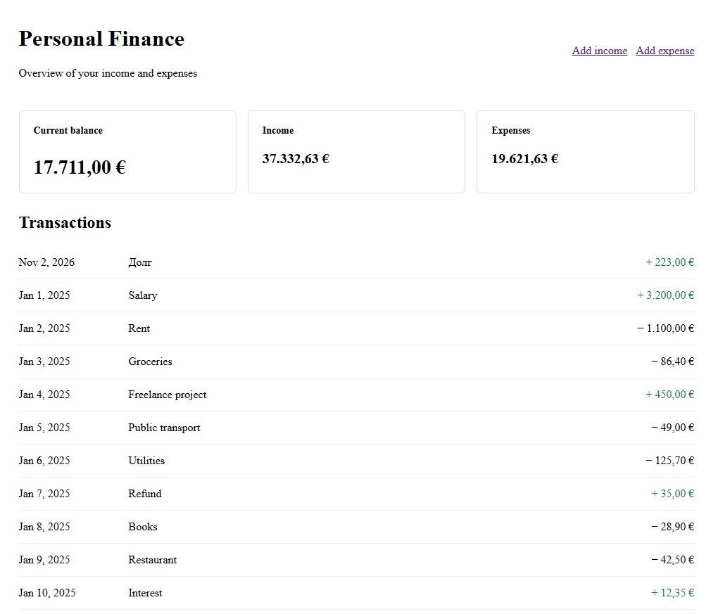
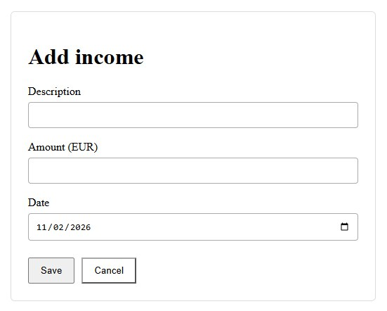
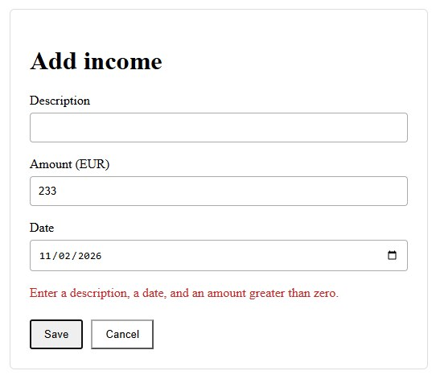
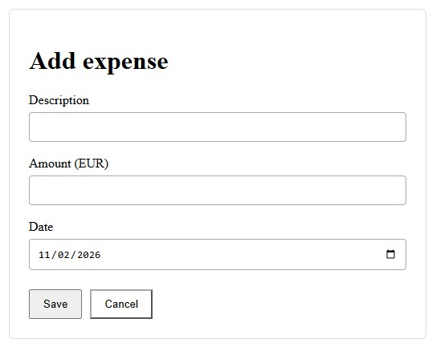
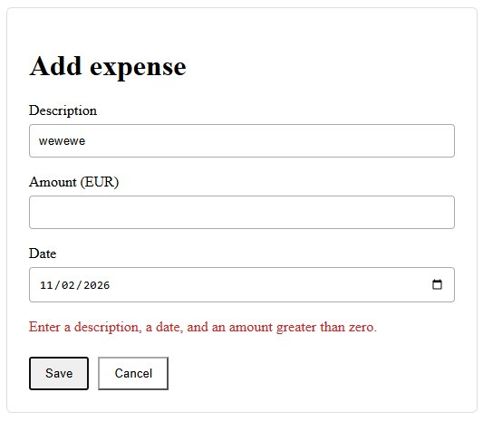
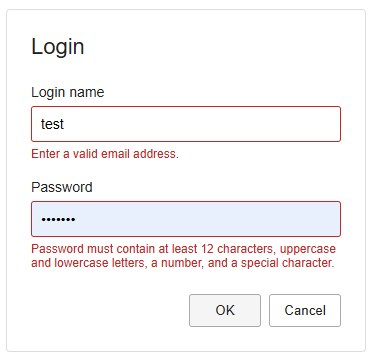
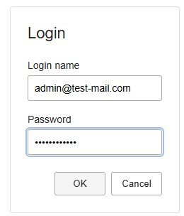

# Angular in Depth — Part 1: Architecture and Components

## 1. Architecture Before Components

Angular provides a structured environment for frontend development. It offers components, dependency injection, reactive state management, HTTP communication, routing, testing tools, and an extensive ecosystem of UI libraries.

However, the availability of these mechanisms does not automatically result in a well-designed application architecture.

A project can use Angular correctly and still become increasingly difficult to maintain. Components grow, services accumulate unrelated responsibilities, state is duplicated across different parts of the application, and dependencies become difficult to trace. Adding another feature may require changes in places that should have remained independent.

These problems are not necessarily caused by Angular. More often, they arise because the responsibilities and boundaries of the application were not defined clearly enough.

We will therefore start with those boundaries and then look at the Angular mechanisms that help turn architectural decisions into code.

The purpose of this article is not to prescribe a universal architecture for every Angular application. Instead, we will examine the reasoning behind architectural decisions and use the Personal Finance application as a practical example throughout this series.

### 1.1. Architecture Is About Responsibilities and Dependencies

Software architecture is not defined by the number of layers, the directory structure, or the number of libraries used.

First and foremost, it defines how a system is divided into areas of responsibility and how those areas interact.

Consider a page that displays a user's expenses. Several different activities are required:

- Displaying the list of expenses and handling user interactions.
- Managing the state currently displayed in the UI.
- Coordinating operations such as loading, creating, or updating expenses.
- Communicating with the backend.
- Handling errors and translating them into application states the UI can present.
- Applying shared visual and interaction rules.

These activities are related, but they are not the same responsibility.

If one component handles all of them, changing one part of the application becomes difficult without affecting the others. For example, a backend contract change may require modifying a component that also contains presentation logic and state calculations.

Separating responsibilities makes such changes more predictable. It also creates clearer points for testing, reuse, and further evolution.

This does not mean that every responsibility immediately needs its own class or library. A small application may not need several layers for a simple feature. It is important to distinguish understanding responsibilities from deciding how strongly they should be separated structurally.

Architecture should make a system easier to understand and change, not merely add abstractions.

### 1.2. The Main Areas of Responsibility in a Frontend Application

For Personal Finance, it is useful to distinguish four broad areas of responsibility.

**User interface**

The UI displays information and allows users to interact with the application. It includes pages, components, templates, and visual elements.

Its primary task is to support user interaction. It does not need to know the details of an HTTP request or how the backend stores a financial transaction.

**Application logic and coordination**

This area coordinates operations initiated by the user. It determines which actions need to be performed, how the corresponding state should be updated, and how the application should react to success or failure.

Depending on the application's complexity, this responsibility may be implemented in a component, a service, a facade, or a combination of these.

**State management**

The application needs a consistent representation of the information currently relevant to the UI. This may include loaded expenses, loading indicators, selected filters, and calculated totals.

The architecture should make it clear which part of the application owns a particular piece of state, which parts can read it, and how changes are propagated.

Not every value requires a shared state management mechanism. Temporary state belonging to a single component can often remain inside that component.

**Data access and external communication**

This area is responsible for communication with the backend and other external systems. It includes HTTP requests, response handling, and technical details of the API contract.

Separating these concerns from presentation allows the UI to evolve without becoming tightly coupled to the transport layer.

These four areas are a conceptual model, not a mandatory four-layer architecture. They help us reason about responsibilities. In a real project, some areas may be combined, while others may need further separation.

### 1.3. Tracing Data Through the Application

One useful way to evaluate an architecture is to trace the complete path of an operation from the UI to the backend and back.

Imagine that a user opens the expenses page in Personal Finance.

1. The page initiates a loading operation.
2. The application coordinates the request and exposes the current loading state.
3. The data-access service sends an HTTP request to the backend.
4. The response is returned and processed.
5. The application state is updated.
6. The UI reacts to the new state and displays the expenses.

If the request fails, the application follows an alternative path: it records or exposes the corresponding error state, completes the loading operation, and allows the UI to display an appropriate message.

The actual implementation may vary. A simple feature may need only a component and a service, while a more complex one may benefit from a facade and a dedicated state service.

The important point is that the data flow remains understandable.

A component does not need to know how an HTTP request is constructed. A data-access service should not decide how a particular error message is displayed. Calculated values, such as the total expenses, should not be duplicated unnecessarily as independently maintained state.

When these responsibilities are mixed, the data flow becomes harder to follow. When they are explicit, it is easier to understand where a change belongs and how to verify its consequences.

### 1.4. Boundaries Should Reflect Responsibilities and Reasons for Change

A useful architectural boundary separates responsibilities that are likely to change for different reasons.

For example, the visual representation of the expenses page may change when the design system is updated. The backend contract may change as the API evolves. The rules for calculating the financial summary may change because of new business requirements.

If all these concerns are tightly coupled, every change creates unnecessary risk for the other parts of the application.

Separation does not eliminate all dependencies. The UI still needs data, application logic must communicate with external systems, and state must reflect the results of operations.

The goal is to make dependencies explicit and limit them to what is actually necessary.

That is why a shared UI component should not automatically depend on an API service belonging to a specific feature. For the same reason, a data-access service should not depend on the visual component that consumes its results.

The direction of dependencies matters: it affects how easily an individual part of the application can be reused, tested, or replaced.

### 1.5. Avoiding Both Underengineering and Overengineering

Two opposite mistakes are common when designing frontend architecture.

The first is postponing architectural decisions until the application becomes difficult to maintain. Components gradually accumulate unrelated tasks, services turn into general-purpose containers, and shared state is introduced without a clear understanding of who owns it.

The second is creating a complex architecture before the application's requirements justify it. Every component gets a facade, every operation gets a separate service, and even simple interactions have to pass through several layers.

Neither extreme is desirable.

It is better to define responsibilities from the beginning and introduce additional boundaries when they solve a concrete problem.

A separate service may be justified when functionality needs to be reused, tested independently, or separated from the UI. A facade may be useful when several components need a consistent interface for operations and application state. A separate NX library may make sense when a real functional boundary or reuse requirement emerges.

These decisions should follow the needs of the application, not the desire to reproduce a predefined directory structure.

The question is not whether the architecture has enough layers. The question is whether its boundaries make the system easier to understand, test, and change.

### 1.6. How Angular and NX Help Implement Architectural Decisions

Angular provides mechanisms that help express application boundaries.

Components encapsulate parts of the UI. Dependency Injection makes dependencies explicit and allows Angular to manage object creation and configuration. Services provide a place for functionality that should not be tied to a particular visual component. Signals and RxJS offer different approaches to representing state and handling asynchronous operations.

These mechanisms are useful because they support architectural decisions. They do not make those decisions automatically.

When an application grows to include multiple projects and libraries, NX provides additional capabilities. It helps organize code into separate projects and enforce constraints on dependencies between them.

This becomes especially useful when Personal Finance evolves beyond a single application and starts to include reusable UI elements, feature libraries, and separate data-access functionality.

However, creating separate projects does not automatically create meaningful boundaries. A poorly designed dependency structure remains poorly designed even when every part is placed in its own library.

We will return to these decisions in later parts of the series, where we will look at Dependency Injection, state management, API communication, and organizing an Angular application inside an NX workspace.

For now, we will follow a simple principle: first understand the application's responsibilities and dependencies, then use Angular and NX to express and enforce the boundaries that are genuinely useful.

### 1.7. Workspace Structure: Where the Code Belongs and Why

We can now translate architectural boundaries into the structure of an NX workspace. A directory alone does not make code reusable or independent. Every project and folder needs a clear responsibility, and dependency direction must remain controlled.

Our learning workspace uses four main areas:

- `apps` — application entry points and build configurations.
- `libs` — libraries containing functionality and contracts, separated by responsibility.
- `common` — resources and configuration shared by applications but not representing a standalone business-logic library.
- Root configuration files — workspace-wide rules and settings for NX, TypeScript, ESLint, formatting, and development tools.

#### The Application as the Composition Root

`apps/personal-finance` contains configuration specific to the application: bootstrap, top-level routes, providers, the root component, and build settings. The application assembles the required libraries and connects them into a running system.

The application should not become the place where all functionality is stored. Pages, reusable components, contracts, and data have their own areas of responsibility.

#### Feature Libraries

`libs/personal-finance/pages` contains pages and components that belong specifically to Personal Finance:

```text
libs/personal-finance/pages/
└── src/
    ├── index.ts
    └── lib/
        ├── components/
        │   └── login/
        ├── state/
        │   └── transaction.store.ts
        └── views/
            ├── dashboard/
            ├── login/
            └── transaction-form/
```

The `views` folder contains pages used by routing. The `components` folder contains composite UI components used by those pages. The `state` folder contains state whose scope is currently limited to this library.

We do not create a nested path such as `pages/src/lib/pages`: the library name already defines the responsibility. Repeating it at every level adds no value.

In this small learning application, `TransactionStore` remains next to the pages because its consumers and scope are limited to this feature library. This is a deliberate simplification, not a universal rule. If state and application operations become necessary across several libraries or form an independent functional boundary, they can be moved, for example, to `libs/personal-finance/facades`. A feature-specific store should not be placed in `libs/shared/facades`: shared is for genuinely shared capabilities, not code merely used by several components of one application.

#### Shared Libraries

`libs/shared` contains code that does not belong exclusively to Personal Finance and can be used by other applications or feature libraries.

| Library | Responsibility |
|---|---|
| `shared/definitions` | Shared contracts and definitions: interfaces, types, enums, constants, classes, abstracts, and records |
| `shared/ui` | Reusable UI components, directives, and pipes |
| `shared/base` | Common foundational functionality, when it is genuinely needed by multiple parts of the system |
| `shared/facades` | Shared facades coordinating interaction with shared capabilities |
| `shared/dal` | Shared data-access infrastructure that does not depend on a specific feature |

In the current example, the most substantial libraries are `definitions` and `ui`. The `base`, `facades`, and `dal` projects exist as separate workspace projects, but their presence does not mean that code must be placed in them artificially. A library gets an implementation when a real responsibility emerges.

Feature-specific data access should be placed in the corresponding feature area when needed, for example `libs/personal-finance/dal`, rather than automatically in `libs/shared/dal`. The criterion is responsibility and the possibility of independent reuse.

#### Definitions: Group by Kind, Not by Feature

Definitions in `libs/shared/definitions/src/lib` are grouped by their nature:

```text
definitions/src/lib/
├── abstracts/
├── classes/
├── constants/
├── enums/
├── interfaces/
├── records/
└── types/
```

Each definition has its own TypeScript file. Examples include:

- `interfaces/transaction.ts` — transaction contract;
- `enums/transaction-type.enum.ts` — numeric transaction type;
- `interfaces/login-credentials.ts` — login form data contract;
- `interfaces/field-validation-result.ts` — shared validation result;
- `constants/routes.ts` — centralized route values;
- `constants/validation.regex.ts` — shared regular expressions.

Do not create `models`, `utils`, or `helpers` folders that mix different kinds of definitions. The category is determined by the kind of entity, not by the page that uses it.

Public exports are collected in the index files of the respective categories and exposed through aliases. This gives the library an explicit public API and prevents consumers from importing through internal paths.

#### Mock: A Separate Shared Library

Demo data is located in `libs/mock`, not inside `libs/personal-finance` or a particular feature library:

```text
libs/mock/
├── project.json
├── tsconfig.json
├── tsconfig.lib.json
└── src/
    ├── index.ts
    └── lib/
        └── demo-transactions.mock.ts
```

Mock data may be needed not only by Personal Finance, but also by test scenarios, demo pages, or other applications. Therefore, the library is shared and uses the alias `@workshop:mock`.

This does not mean that every test fixture from every library should be placed in mock. This library contains shared demonstration datasets. Test fixtures required by only one test or one library can remain next to that test. For this learning application, the separate shared mock library is the single place for data used as the application's initial content.

The mock library intentionally has no dedicated test suite or Vitest configuration because it contains static demonstration data. The other libraries, including `shared/definitions`, retain their test infrastructure.

#### Common: Shared Resources and Configuration

The `common` directory is not another business-logic library. It contains shared resources, styles, and configuration:

```text
common/
├── assets/
├── environments/
│   ├── common.ts
│   ├── environment.dev.ts
│   ├── environment.prod.ts
│   └── environment.test.ts
└── styles/
    └── common.scss
```

For example, `COMMON.DEFAULT_CURRENCY` defines the default currency, while `common/styles/common.scss` contains shared styles. Shared assets do not need to be copied into every application.

#### Aliases: Public Names of Libraries

TypeScript path aliases are defined centrally in the root `tsconfig.base.json`. The workspace uses one namespace, `@workshop:`:

| Alias | Purpose |
|---|---|
| `@workshop:ui` | Shared UI |
| `@workshop:mock` | Shared mock data |
| `@workshop:facades` | Shared facades |
| `@workshop:dal` | Shared data access |
| `@workshop:base` | Shared base |
| `@workshop:def:consts` | Definitions: constants |
| `@workshop:def:abstracts` | Definitions: abstract classes |
| `@workshop:def:classes` | Definitions: classes |
| `@workshop:def:enums` | Definitions: enums |
| `@workshop:def:interfaces` | Definitions: interfaces |
| `@workshop:def:records` | Definitions: records |
| `@workshop:def:types` | Definitions: types |
| `@workshop:personal-finance:pages` | Personal Finance pages |
| `@workshop:common` | Shared application configuration from `common/environments/common.ts` |

Do not add short alternative aliases such as `base`, `dal`, or `facades` for the same libraries. Two names for the same path create ambiguity and gradually lead to inconsistent import styles. An alias is part of a library's public contract and should remain consistent.

#### How This Relates to NX Boundaries

Directories help people navigate a workspace, but architectural constraints should be checked by tools. NX projects therefore receive tags, and module boundary rules restrict permitted dependencies.

In our convention, libraries receive the `level:shared` tag and their own `tag:<library-name>` tag. The application receives `level:app` and `app:<app-name>`. ESLint/NX uses these tags to validate dependencies. As a result, the rule that shared code must not depend on a specific application becomes an enforceable constraint rather than just a team agreement.

The folder structure answers “where can I find the code?”, public aliases answer “how do I access it?”, and NX boundaries answer “which project is allowed to depend on which other project?”. These are three different mechanisms that complement one another.

## 2. LoginComponent: From User Input to an Updated View

For a practical example, consider the Personal Finance login form. The component stores the entered values, receives validation results from directives, and informs the parent page when local validation succeeds.

LoginComponent and the application pages are located in the app-specific library `libs/personal-finance/pages`. Reusable directives are placed in `libs/shared/ui`.

### 2.1. Component Structure

The LoginComponent implementation is split into three files: `login.component.ts` contains state and handlers, `login.component.html` contains markup and Angular bindings, and `login.component.scss` contains local styles. The source files are located in `libs/personal-finance/pages/src/lib/components/login/`.

#### 2.1.1. login.component.ts

The component does not contain regular expressions. It imports both directives from `@workshop:ui`, receives validation results, and stores messages for the template.

```typescript
import { Component, ViewChild, output } from '@angular/core';
import type { FieldValidationResult, LoginCredentials } from '@workshop:def:interfaces';
import { EmailValidatorDirective, PasswordValidatorDirective } from '@workshop:ui';

/** Presents the login form and coordinates reusable field validators. */
@Component({
  selector: 'app-login',
  standalone: true,
  imports: [EmailValidatorDirective, PasswordValidatorDirective],
  templateUrl: './login.component.html',
  styleUrl: './login.component.scss',
})
export class LoginComponent {
  /** Emits credentials after both fields pass local validation. */
  readonly loginRequested = output<LoginCredentials>();

  /** References the email validator hosted by the login form. */
  @ViewChild(EmailValidatorDirective)
  private emailValidator!: EmailValidatorDirective;

  /** References the password validator hosted by the login form. */
  @ViewChild(PasswordValidatorDirective)
  private passwordValidator!: PasswordValidatorDirective;

  /** Stores the current email value. */
  protected email = '';

  /** Stores the current password value. */
  protected password = '';

  /** Holds the current email validation message. */
  protected emailError = '';

  /** Holds the current password validation message. */
  protected passwordError = '';

  /** Stores the current email value. */
  protected onEmailInput(value: string): void {
    this.email = value;
  }

  /** Stores the current password value. */
  protected onPasswordInput(value: string): void {
    this.password = value;
  }

  /** Updates the email validation feedback. */
  protected onEmailValidationChange(result: FieldValidationResult): void {
    this.emailError = result.message;
  }

  /** Updates the password validation feedback. */
  protected onPasswordValidationChange(result: FieldValidationResult): void {
    this.passwordError = result.message;
  }

  /** Validates both fields and emits credentials when locally valid. */
  protected onSubmit(event: SubmitEvent): void {
    event.preventDefault();
    const emailResult = this.emailValidator.validateNow();
    const passwordResult = this.passwordValidator.validateNow();

    if (!emailResult.valid || !passwordResult.valid) {
      return;
    }

    this.loginRequested.emit({
      email: this.email.trim(),
      password: this.password,
    });
  }

  /** Clears the form and resets the validation directives. */
  protected onCancel(): void {
    this.email = '';
    this.password = '';
    this.emailError = '';
    this.passwordError = '';
    this.emailValidator.reset();
    this.passwordValidator.reset();
  }
}
```

`ViewChild` gives the component references to the directives so that both validations can be explicitly triggered before the form is submitted. The signal-based `output()` emits the `loginRequested` event to the parent page. The `LoginCredentials` contract is imported from `@workshop:def:interfaces`, rather than declared inside the component file. This is not authentication: the server must validate credentials independently.

#### 2.1.2. login.component.html

In the template, each field is connected to its corresponding directive. The `input` event stores the entered value, while the directive output provides the validation result.

```html
<input
  id="login-name"
  type="email"
  [value]="email"
  appEmailValidator
  (input)="onEmailInput($any($event.target).value)"
  (emailValidationChange)="onEmailValidationChange($event)"
  [attr.aria-invalid]="!!emailError"
/>

<input
  id="password"
  type="password"
  [value]="password"
  appPasswordValidator
  (input)="onPasswordInput($any($event.target).value)"
  (passwordValidationChange)="onPasswordValidationChange($event)"
  [attr.aria-invalid]="!!passwordError"
/>
```

Validation messages are rendered using `@if`. The `novalidate` attribute allows our submit handler to control validation, while `required` preserves the semantics of a mandatory field.

#### 2.1.3. login.component.scss

The form's local styles are stored in a separate SCSS file. Shared application styles remain in `common/styles/`. The Angular builder compiles SCSS into CSS; the browser receives the compiled styles.

### 2.2. What the Component Does

The component is responsible for the state of this particular form and for coordinating its interactions: it stores the email and password, receives directive results, displays messages, triggers validation again on submission, and emits `loginRequested` when local validation succeeds.

## 3. Change Detection: How Angular Updates the View

Change Detection is the Angular mechanism that synchronizes the view with application state. When a user enters a character, the browser generates an `input` event, Angular invokes the handlers, the component updates its value, and the directive emits a validation result. Updating the property that stores an error message causes the corresponding part of the template to be refreshed.

The sequence is as follows:

1. The user changes a field value.
2. The browser generates an `input` event.
3. Angular invokes the component and directive handlers.
4. The component and directive update their state and provide the validation result.
5. Angular synchronizes the view with the new state.
6. The user sees the current value and, when necessary, an error message.

In this example, we do not need to modify the DOM manually or trigger view checking ourselves. We update state in handlers registered through the Angular template.

Historically, Angular widely used Zone.js to track asynchronous operations and determine when checking might be required. Modern versions also support a zoneless approach that works without Zone.js. This does not remove Change Detection; it changes how Angular learns that an update is needed.

Official documentation: [Angular — Zoneless](https://angular.dev/guide/zoneless).

## 4. Why We Use the input Event

The `(input)` binding reacts to a change in the field's value, not only to a key being pressed. For example, a value can also be changed by pasting text through the context menu. The `input` event therefore matches the task of validating the current field value more accurately.

## 5. Directives: Reusing Behavior

Email and password validation may be needed in different forms. That is why both directives are located in `libs/shared/ui`, rather than inside the Pages library of a specific application.

The regular expressions themselves do not belong to the UI. They are placed in `libs/shared/definitions/src/lib/constants/validation.regex.ts`. This allows the same rules to be used by different components without duplicating expressions.

### 5.1. Validation Result Contract

Both directives pass the same structure to the component:

```typescript
export interface FieldValidationResult {
  /** Indicates whether the field value passed validation. */
  valid: boolean;
  /** Contains validation feedback for the user. */
  message: string;
}
```

The interface is located in `libs/shared/definitions/src/lib/interfaces/field-validation-result.ts` and is exported through `@workshop:def:interfaces`.

### 5.2. Centralized Regular Expressions

```typescript
export const VALIDATION_REGEX = {
  EMAIL: /^[^\s@]+@[^\s@]+\.[^\s@]+$/,
  PASSWORD: /^(?=.*[a-z])(?=.*[A-Z])(?=.*\d)(?=.*[^A-Za-z0-9\s]).{12,}$/,
} as const;
```

The file is exported from `@workshop:def:consts`. The email check rejects some obviously invalid values, but it does not prove that an address exists. In this learning example, the password rule requires at least 12 characters, uppercase and lowercase Latin letters, a digit, and a special character. This is a demonstration policy, not a universal security recommendation.

### 5.3. EmailValidatorDirective and PasswordValidatorDirective

The directives are standalone classes attached to HTML elements through the `[appEmailValidator]` and `[appPasswordValidator]` attributes. They use `ElementRef` only to read the field value, listen to the `input` and `blur` events, and emit the result through signal-based `output()`.

Each directive exposes two public methods:

- `validateNow()` — marks the field as interacted with, runs validation, and returns the result;
- `reset()` — resets the internal interaction flag and clears the message.

The directive does not modify the DOM or display errors. That is the responsibility of the component and its template. Both directive implementations are located in `libs/shared/ui/src/lib/directives/`.

### 5.4. Connecting the Directives to LoginComponent

The standalone directives are imported into the component's `imports` array. The `@ViewChild` references make it possible to run validation again when the form is submitted, even if the user has not left the field. Each directive publishes its result through `output()`; the component receives it and decides when and how to display messages.

Thus, `shared/definitions` stores rules and types, `shared/ui` implements reusable behavior, and `LoginComponent` manages form state and feedback presentation.

### 5.5. Architectural Takeaways

- Reusable UI behavior belongs in `shared/ui`.
- Regular expressions belong in `shared/definitions`, not inside directives or components.
- A directive validates a value and emits the result, but does not manage messages.
- The component owns form state and defines the UI behavior.
- Client-side validation improves feedback but does not replace server-side validation.

## 6. Pipes: Formatting Display Values

A pipe transforms a value for display in a template without changing the underlying model. For monetary values, we use the built-in `CurrencyPipe`. The default currency is centralized in `common/environments/common.ts`:

```typescript
export const COMMON = {
  DEFAULT_CURRENCY: 'EUR' as const,
};
```

The page receives the configuration and passes the currency to the pipe:

```typescript
readonly currency = COMMON.DEFAULT_CURRENCY;
```

```html
<p>{{ store.balance() | currency: currency : 'symbol' : '1.2-2' }}</p>
```

`CurrencyPipe` formats a numeric value as a monetary amount. It does not convert currencies or change the amount in the model. If support for multiple currencies is required, conversion becomes a separate business operation involving an exchange rate, the rate date, and rounding rules.

`DatePipe` formats the transaction date for the UI. The original date remains a string in the model and can be used for sorting and filtering.

Documentation: [Angular — Pipes](https://angular.dev/guide/templates/pipes) and [CurrencyPipe API](https://angular.dev/api/common/CurrencyPipe).

## 7. Implementation: The Personal Finance Application

The pages are located in the app-specific library `libs/personal-finance/pages`. Reusable directives remain in `libs/shared/ui`, shared types, interfaces, enums, and constants are in `libs/shared/definitions`, and demonstration data is in the separate shared library `libs/mock`.

### 7.1. Model and Shared State

A transaction contains an identifier, type, description, amount, and date. The amount is stored as a positive number, while the direction is defined by the numeric enum `TransactionType`: `income = 1`, `expense = -1`. This makes it possible to calculate the balance as the sum of `amount * type` without storing repeated string values such as `income` and `expense` in JSON.

`TransactionStore` owns the collection of transactions and exposes it through a Signal. Computed signals calculate the balance, total income, and total expenses. After the collection changes, the service stores it in `localStorage`. This is demonstration client-side storage, not a replacement for a backend or synchronization between devices.

Definitions are split into separate files and exported through public aliases:

```typescript
// libs/shared/definitions/src/lib/enums/transaction-type.enum.ts
export enum TransactionType {
  /** Adds an amount to the account balance. */
  income = 1,
  /** Subtracts an amount from the account balance. */
  expense = -1,
}
```

```typescript
// libs/shared/definitions/src/lib/interfaces/transaction.ts
import type { TransactionType } from '@workshop:def:enums';

export interface Transaction {
  /** Identifies the transaction uniquely. */
  id: string;
  /** Identifies whether the transaction adds to or subtracts from the balance. */
  type: TransactionType;
  /** Describes the transaction. */
  description: string;
  /** Stores the transaction amount in the configured currency. */
  amount: number;
  /** Stores the transaction date in ISO date format. */
  date: string;
}
```

These are shortened versions of the contracts; in the source files, each property has an English documentation comment. The enum belongs in the `enums` category and the interface in `interfaces`. They should not be declared together in one file, nor should the enum be duplicated as a string union type. The code uses `TransactionType.income` and `TransactionType.expense`, exactly as defined in the enum.

### 7.2. Mock Data

The initial set of demonstration transactions is located in `libs/mock/src/lib/demo-transactions.mock.ts` and exported through `@workshop:mock`. It currently contains 240 records. `TransactionStore` imports the dataset but does not own its definition.

Numeric enum values are serialized into JSON. For example, the `type` field contains `1` or `-1`, not the strings `"income"` or `"expense"`. This reduces repeated values and makes the transaction direction part of the model. However, an enum does not replace input validation: data restored from external JSON or received from a backend must still be validated at the application boundary.

### 7.3. Application Pages

`LoginPage` hosts `LoginComponent` and demonstrates navigation to the Dashboard after successful local validation. This is not full authentication.

`DashboardPage` displays the balance and transaction history. Amounts use `CurrencyPipe` with the currency from `COMMON.DEFAULT_CURRENCY`, while dates use `DatePipe`.

`TransactionFormPage` handles adding income and expenses. The transaction type is passed through route `data`. The form uses basic HTML attributes and a submit handler; Angular Forms are not introduced in this implementation.

### 7.4. Application Screens

The following screenshots show the main pages of the demonstration application and the form validation states. The links open the corresponding routes in a locally running application (NX uses `http://localhost:4200` by default).

**Dashboard**

Link to the Dashboard on your local machine: [http://localhost:4200/dashboard](http://localhost:4200/dashboard)



**Adding Income**

Link to the income form on your local machine: [http://localhost:4200/add-income](http://localhost:4200/add-income)



Form validation with empty or invalid values:



**Adding an Expense**

Link to the expense form on your local machine: [http://localhost:4200/add-expense](http://localhost:4200/add-expense)



Form validation with empty or invalid values:



**Login**

Link to the Login page on your local machine: [http://localhost:4200/login](http://localhost:4200/login)

Invalid values and validation messages:



Demonstration form with valid input:



In this example, Login demonstrates client-side validation and navigation to the Dashboard only. It does not perform real authentication and must not be treated as a complete security mechanism.

### 7.5. Centralized Routes

All route values are located in `libs/shared/definitions/src/lib/constants/routes.ts`:

```typescript
export const ROUTE = {
  LOGIN: 'login',
  DASHBOARD: 'dashboard',
  ADD_INCOME: 'add-income',
  ADD_EXPENSE: 'add-expense',
  ROOT: '',
  NOT_FOUND: '**',
} as const;
```

`app.routes.ts` uses these constants for lazy loading pages. The root path redirects to the Dashboard, and unknown routes also return the user to the Dashboard. Routing alone does not provide authorization.

## 8. Verification Before Publication

After integration, verify the project in the workspace:

- `npx nx show projects` — confirm that NX detects the new libraries;
- `npx nx lint personal-finance` — run lint if the target is configured;
- `npx nx build personal-finance` — verify the application build;
- open `/login` and check both directives, validation messages, and form reset;
- navigate to the Dashboard and add income and an expense;
- reload the page and verify that the list is restored from `localStorage`.

This is a verification plan, not a statement that the commands have already been run. The build and lint commands must be executed in the local workspace.

## Conclusion

Components manage presentation and local form state, directives extract reusable behavior, pipes format values, and routes and shared services connect the application pages.

Code placement follows responsibility: reusable UI directives belong in Shared UI, shared contracts and definitions belong in Definitions, demonstration data belongs in the shared Mock library, and Personal Finance pages and their currently local state belong in the app-specific library.

## Official Documentation

- [Angular — Components](https://angular.dev/guide/components)
- [Angular — Templates](https://angular.dev/guide/templates)
- [Angular — Directives](https://angular.dev/guide/directives)
- [Angular — Pipes](https://angular.dev/guide/templates/pipes)
- [Angular — Signals](https://angular.dev/guide/signals)
- [Angular — Routing](https://angular.dev/guide/routing)
