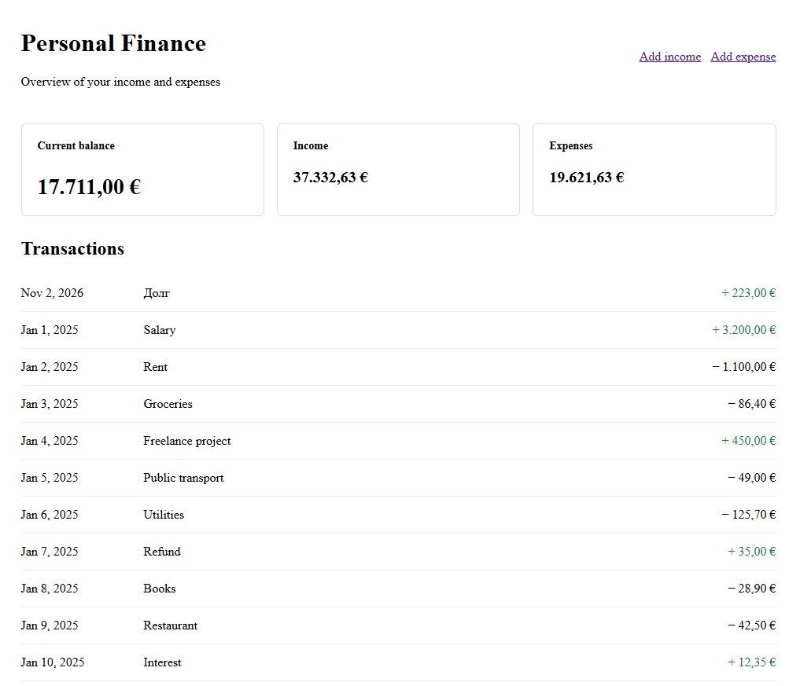
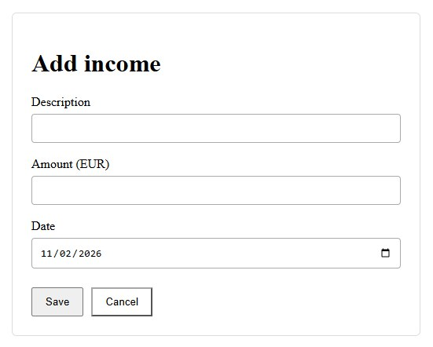
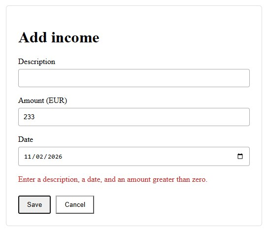
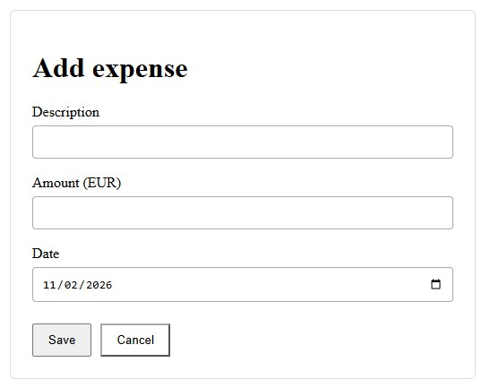
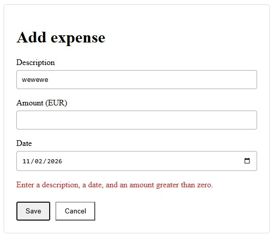
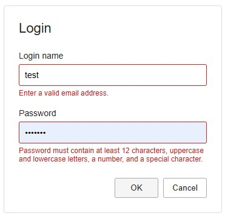
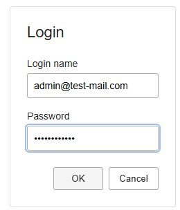

# Angular in Depth — Часть 1: Архитектура и компоненты

## 1. Архитектура до компонентов

Angular предоставляет структурированную среду для разработки frontend-приложений. Он предлагает компоненты, внедрение зависимостей, управление реактивным состоянием, HTTP-коммуникацию, маршрутизацию, инструменты тестирования и обширную экосистему UI-библиотек.

Однако наличие этих механизмов само по себе не гарантирует хорошую архитектуру приложения.

Проект может технически корректно использовать Angular и при этом становиться всё сложнее в сопровождении. Компоненты разрастаются, сервисы накапливают несвязанные обязанности, состояние дублируется в нескольких частях приложения, а зависимости становится трудно проследить. Добавление очередной функции требует изменений в тех местах, которые должны были оставаться независимыми.

Эти проблемы не обязательно вызваны самим Angular. Чаще они возникают потому, что обязанности и границы приложения не были определены достаточно чётко.

Поэтому начнём с этих границ, а уже затем перейдём к механизмам Angular, которые помогают воплотить архитектурные решения в коде.

Цель этой статьи — не предложить универсальную архитектуру, которой должно следовать каждое Angular-приложение. Вместо этого мы рассмотрим логику архитектурных решений и будем использовать приложение Personal Finance в качестве практического примера на протяжении всей серии.

### 1.1. Архитектура — это ответственность и зависимости

Архитектура программного обеспечения определяется не количеством слоёв, структурой каталогов или числом используемых библиотек.

В первую очередь она определяет, как система разделена на отдельные области ответственности и как эти области взаимодействуют друг с другом.

Рассмотрим страницу, отображающую расходы пользователя. Для её работы требуется несколько разных видов деятельности:

- Отображение списка расходов и обработка пользовательских действий.
- Управление состоянием, которое в данный момент отображается в интерфейсе.
- Координация операций, например загрузки, создания или изменения расходов.
- Взаимодействие с backend.
- Обработка ошибок и преобразование их в понятные состояния приложения.
- Применение общих правил оформления и взаимодействия с интерфейсом.

Эти задачи связаны между собой, но не являются одной и той же ответственностью.

Если один компонент выполняет их все, становится трудно менять одну часть приложения, не затрагивая остальные. Например, изменение контракта backend может потребовать модификации компонента, который одновременно содержит логику отображения и вычисления состояния.

Разделение ответственности делает такие изменения более предсказуемыми. Оно также создаёт более понятные точки для тестирования, повторного использования и дальнейшего развития приложения.

Это не означает, что для каждой ответственности нужно немедленно создавать отдельный класс или библиотеку. Небольшому приложению может не понадобиться несколько слоёв для простой функции. Важно различать понимание обязанностей и решение о том, насколько сильно их следует разделять структурно.

Архитектура должна упрощать понимание и изменение системы, а не просто добавлять новые абстракции.

### 1.2. Основные области ответственности frontend-приложения

Для нашего приложения Personal Finance полезно выделить четыре широкие области ответственности.

**Пользовательский интерфейс**

UI отображает информацию и позволяет пользователю взаимодействовать с приложением. Он включает страницы, компоненты, шаблоны и визуальные элементы.

Его основная задача — обеспечить взаимодействие с пользователем. Ему не обязательно знать детали HTTP-запроса или то, как backend хранит финансовую операцию.

**Прикладная логика и координация**

Эта область координирует операции, инициированные пользователем. Она определяет, какие действия необходимо выполнить, как обновить соответствующее состояние и как приложение должно реагировать на успех или ошибку.

В зависимости от сложности приложения эта ответственность может быть реализована в компоненте, сервисе, фасаде или их комбинации.

**Управление состоянием**

Приложению необходимо согласованное представление информации, актуальной для пользовательского интерфейса. Это могут быть загруженные расходы, индикаторы загрузки, выбранные фильтры и вычисляемые итоговые суммы.

Архитектура должна позволять понять, какая часть приложения владеет определённым состоянием, какие части могут его читать и каким образом распространяются изменения.

Не каждое значение требует общего механизма управления состоянием. Временное состояние, относящееся к одному компоненту, часто можно оставить внутри этого компонента.

**Доступ к данным и внешнее взаимодействие**

Эта область отвечает за взаимодействие с backend и другими внешними системами. Она включает HTTP-запросы, обработку ответов и технические детали контракта API.

Отделение этих задач от представления позволяет изменять интерфейс, не связывая его слишком тесно с транспортным уровнем.

Эти четыре области представляют собой концептуальную модель, а не обязательную четырёхслойную архитектуру. Их задача — помочь нам рассуждать об ответственности. В реальном проекте некоторые области могут быть объединены, а другие, напротив, потребуют дальнейшего разделения.

### 1.3. Прослеживаем данные через приложение

Один из полезных способов оценить архитектуру — проследить полный путь операции от пользовательского интерфейса до backend и обратно.

Представим, что пользователь открывает страницу расходов в Personal Finance.

1. Страница инициирует операцию загрузки.
2. Приложение координирует запрос и предоставляет текущее состояние загрузки.
3. Сервис доступа к данным отправляет HTTP-запрос в backend.
4. Ответ возвращается и обрабатывается.
5. Состояние приложения обновляется.
6. UI реагирует на новое состояние и отображает расходы.

Если запрос завершается ошибкой, приложение проходит альтернативный путь: фиксирует или предоставляет соответствующее состояние ошибки, завершает операцию загрузки и позволяет интерфейсу показать подходящее сообщение.

Конкретная реализация может различаться. Для простой функции могут быть достаточно компонента и сервиса, а для более сложной функции может понадобиться фасад и отдельный сервис состояния.

Главное, чтобы поток данных оставался понятным.

Компоненту не обязательно знать, как формируется HTTP-запрос. Сервису доступа к данным не следует решать, как именно отображается конкретное сообщение об ошибке. Вычисляемые значения, например общую сумму расходов, не стоит без необходимости дублировать в виде независимо поддерживаемого состояния.

Когда эти обязанности смешаны, поток данных становится сложнее проследить. Когда они определены явно, легче понять, где должно выполняться изменение и как проверить его последствия.

### 1.4. Границы должны учитывать причины изменений и ответственность

Полезная архитектурная граница разделяет обязанности, которые, вероятнее всего, будут изменяться по разным причинам.

Например, визуальное представление страницы расходов может измениться при обновлении дизайн-системы. Контракт backend может измениться вслед за развитием API. Правила расчёта финансовой сводки могут измениться из-за новых бизнес-требований.

Если все эти задачи тесно связаны, каждое изменение создаёт ненужный риск для остальных частей приложения.

Разделение не устраняет все зависимости. Интерфейсу по-прежнему нужны данные, прикладной логике необходимо взаимодействовать с внешними системами, а состояние должно отражать результаты операций.

Цель заключается в том, чтобы сделать зависимости явными и по возможности ограничить их необходимым минимумом.

Именно поэтому общий UI-компонент не должен автоматически зависеть от API-сервиса конкретной функциональной области. По той же причине сервис доступа к данным не должен зависеть от визуального компонента, использующего его результаты.

Направление зависимостей имеет значение: оно влияет на то, насколько легко переиспользовать, тестировать или заменять отдельную часть приложения.

### 1.5. Как избежать недостаточной и избыточной архитектуры

При проектировании архитектуры frontend-приложения часто встречаются две противоположные ошибки.

Первая — откладывать архитектурные решения до тех пор, пока приложение не станет сложным в сопровождении. Компоненты постепенно накапливают несвязанные задачи, сервисы превращаются в универсальные контейнеры, а общее состояние вводится без чёткого понимания того, кто им владеет.

Вторая — создавать сложную архитектуру до того, как требования приложения оправдают её. Для каждого компонента появляется фасад, для каждой операции создаётся отдельный сервис, а простое взаимодействие требует прохождения через несколько слоёв.

Обе крайности нежелательны.

Лучше с самого начала определять ответственность и вводить дополнительные границы тогда, когда они решают конкретную проблему.

Отдельный сервис может быть оправдан, если функциональность нужно повторно использовать, тестировать независимо или отделить от UI. Фасад может оказаться полезным, если нескольким компонентам нужен согласованный интерфейс для работы с операциями и состоянием приложения. Отдельная библиотека NX может иметь смысл, если появляется реальная функциональная граница или потребность в повторном использовании.

Но эти решения должны следовать из потребностей приложения, а не из желания воспроизвести заранее установленную структуру каталогов.

Вопрос заключается не в том, достаточно ли много слоёв содержит архитектура. Вопрос в том, помогают ли её границы лучше понимать, тестировать и изменять систему.

### 1.6. Как Angular и NX помогают реализовать архитектурные решения

Angular предоставляет механизмы, помогающие выражать границы приложения.

Компоненты инкапсулируют части пользовательского интерфейса. Dependency Injection делает зависимости явными и позволяет Angular управлять созданием и настройкой объектов. Сервисы предоставляют место для функциональности, которая не должна быть привязана к конкретному визуальному компоненту. Signals и RxJS предлагают разные подходы к представлению состояния и обработке асинхронных операций.

Эти механизмы полезны потому, что поддерживают архитектурные решения. Однако они не принимают такие решения автоматически.

Когда приложение вырастает и начинает включать несколько проектов и библиотек, NX предоставляет дополнительные возможности. Он помогает организовывать код в отдельные проекты и устанавливать ограничения на зависимости между ними.

Это становится особенно полезным, когда Personal Finance перестаёт быть одним приложением и начинает включать переиспользуемые UI-элементы, функциональные библиотеки и отдельную функциональность доступа к данным.

Однако создание отдельных проектов само по себе не обеспечивает осмысленных границ. Неудачно спроектированная структура зависимостей остаётся неудачной, даже если каждый её элемент размещён в собственной библиотеке.

Мы вернёмся к этим решениям в следующих частях серии, где рассмотрим Dependency Injection, управление состоянием, взаимодействие с API и организацию Angular-приложения внутри NX workspace.

Пока будем придерживаться простого принципа: сначала нужно понять обязанности и зависимости приложения, а затем использовать Angular и NX для выражения и закрепления тех границ, которые действительно полезны.

В следующем разделе мы перейдём от архитектурных принципов к первому конкретному строительному блоку — компонентам Angular, шаблонам и директивам.


### 1.7. Структура workspace: где размещается код и почему

Теперь переведём архитектурные границы в структуру NX workspace. Каталог сам по себе не делает код переиспользуемым или независимым. Для каждого проекта и папки должна быть понятная ответственность, а направление зависимостей должно оставаться контролируемым.

В нашем учебном workspace используются четыре основных области:

- `apps` — точки сборки и запуска приложений.
- `libs` — библиотеки с функциональностью и контрактами, разделённые по области ответственности.
- `common` — ресурсы и конфигурация, общие для приложений, но не являющиеся самостоятельной библиотекой бизнес-логики.
- корневые конфигурационные файлы — правила и настройки всего workspace: NX, TypeScript, ESLint, форматирование и инструкции для инструментов разработки.

#### Приложение — composition root

`apps/personal-finance` содержит конфигурацию конкретного приложения: bootstrap, маршруты верхнего уровня, providers, корневой компонент и настройки сборки. Здесь приложение собирает необходимые библиотеки и связывает их в работающую систему.

Приложение не должно становиться местом хранения всей функциональности. Страницы, переиспользуемые компоненты, контракты и данные имеют собственные области ответственности.

#### Feature libraries — функциональность конкретного продукта

`libs/personal-finance/pages` содержит страницы и компоненты, относящиеся именно к Personal Finance:

```text
libs/personal-finance/pages/
└── src/
    ├── index.ts
    └── lib/
        ├── components/
        │   └── login/
        ├── state/
        │   └── transaction.store.ts
        └── views/
            ├── dashboard/
            ├── login/
            └── transaction-form/
```

Папка `views` предназначена для страниц, которые участвуют в маршрутизации. `components` — для составных UI-компонентов, используемых страницами. `state` содержит состояние, пока оно имеет локальную область применения внутри этой библиотеки.

Мы не создаём вложенный путь `pages/src/lib/pages`: название библиотеки уже определяет область ответственности. Повторять его в каждом уровне дерева нет смысла.

В небольшом учебном приложении `TransactionStore` пока находится рядом со страницами, поскольку его потребитель и область использования ограничены этой feature library. Это осознанное упрощение, а не универсальное правило. Если состояние и прикладные операции понадобятся нескольким библиотекам или станут самостоятельной функциональной границей, их следует вынести, например, в `libs/personal-finance/facades`. Не нужно помещать feature-specific store в `libs/shared/facades`: shared предназначен для действительно общих возможностей, а не для кода, который просто используется несколькими компонентами одного приложения.

#### Shared libraries — общие контракты и технические возможности

`libs/shared` содержит код, который не принадлежит исключительно Personal Finance и может использоваться другими приложениями или feature libraries.

| Библиотека | Ответственность |
|---|---|
| `shared/definitions` | Общие контракты и определения: interfaces, types, enums, constants, classes, abstracts и records |
| `shared/ui` | Переиспользуемые UI-компоненты, директивы и pipes |
| `shared/base` | Общая базовая функциональность, если она действительно нужна нескольким частям системы |
| `shared/facades` | Общие фасады, координирующие взаимодействие с разделяемыми возможностями |
| `shared/dal` | Общая инфраструктура доступа к данным, если она не зависит от конкретной feature |

В текущем примере наиболее содержательные библиотеки — `definitions` и `ui`. `base`, `facades` и `dal` присутствуют как отдельные проекты workspace, но их наличие не означает, что в них нужно искусственно размещать код. Библиотека получает реализацию тогда, когда для неё появляется реальная ответственность.

Feature-specific доступ к данным при необходимости следует размещать в области соответствующей функции, например `libs/personal-finance/dal`, а не автоматически в `libs/shared/dal`. Критерий — область ответственности и возможность независимого повторного использования.

#### Definitions — определения по видам, а не по функциональным папкам

В `libs/shared/definitions/src/lib` определения группируются по своей природе:

```text
definitions/src/lib/
├── abstracts/
├── classes/
├── constants/
├── enums/
├── interfaces/
├── records/
└── types/
```

Каждое определение находится в собственном TypeScript-файле. Например:

- `interfaces/transaction.ts` — контракт операции;
- `enums/transaction-type.enum.ts` — числовой тип операции;
- `interfaces/login-credentials.ts` — контракт данных формы входа;
- `interfaces/field-validation-result.ts` — общий результат проверки;
- `constants/routes.ts` — централизованные значения маршрутов;
- `constants/validation.regex.ts` — общие регулярные выражения.

Здесь не следует создавать папки `models`, `utils` или `helpers` для смешивания разных видов определений. Категория определяется видом сущности, а не тем, какая страница её использует.

Публичные экспорты собраны в индексах соответствующих категорий и доступны через алиасы. Это даёт библиотеке явную публичную поверхность и избавляет потребителей от импорта по внутренним путям.

#### Mock — отдельная общая библиотека

Демонстрационные данные находятся в `libs/mock`, а не внутри `libs/personal-finance` и не внутри конкретной feature library:

```text
libs/mock/
├── project.json
├── tsconfig.json
├── tsconfig.lib.json
└── src/
    ├── index.ts
    └── lib/
        └── demo-transactions.mock.ts
```

Mock-данные могут потребоваться не только Personal Finance, но и тестовым сценариям, демонстрационным страницам или другим приложениям. Поэтому библиотека является общей и имеет алиас `@workshop:mock`.

Это не означает, что в mock нужно помещать любые тестовые fixtures всех библиотек без разбора. Здесь находятся общие демонстрационные наборы данных. Специфические тестовые fixtures, необходимые только одному тесту или одной библиотеке, могут оставаться рядом с этим тестом. Для учебного демонстрационного приложения отдельная общая mock library — единая точка хранения данных, которые используются как начальное содержимое приложения.

Mock library намеренно не имеет собственного набора тестов и конфигурации Vitest: она содержит статические демонстрационные данные. Остальные библиотеки, включая `shared/definitions`, должны сохранять тестовую инфраструктуру.

#### Common — общие ресурсы и конфигурация

Каталог `common` не является ещё одной библиотекой бизнес-логики. Он предназначен для общих ресурсов, стилей и конфигурации:

```text
common/
├── assets/
├── environments/
│   ├── common.ts
│   ├── environment.dev.ts
│   ├── environment.prod.ts
│   └── environment.test.ts
└── styles/
    └── common.scss
```

Например, `COMMON.DEFAULT_CURRENCY` задаёт валюту по умолчанию, а `common/styles/common.scss` содержит общие стили. Общие assets не нужно копировать в каждое приложение.

#### Алиасы — публичные имена библиотек

TypeScript path aliases определяются централизованно в корневом `tsconfig.base.json`. В проекте используется единое пространство имён `@workshop:`:

| Алиас | Назначение |
|---|---|
| `@workshop:ui` | Shared UI |
| `@workshop:mock` | Общие mock-данные |
| `@workshop:facades` | Shared facades |
| `@workshop:dal` | Shared data access |
| `@workshop:base` | Shared base |
| `@workshop:def:consts` | Definitions: constants |
| `@workshop:def:abstracts` | Definitions: abstract classes |
| `@workshop:def:classes` | Definitions: classes |
| `@workshop:def:enums` | Definitions: enums |
| `@workshop:def:interfaces` | Definitions: interfaces |
| `@workshop:def:records` | Definitions: records |
| `@workshop:def:types` | Definitions: types |
| `@workshop:personal-finance:pages` | Страницы Personal Finance |
| `@workshop:common` | Общая конфигурация приложения из `common/environments/common.ts` |

Не следует добавлять короткие альтернативы вроде `base`, `dal` или `facades` для тех же самых библиотек. Два имени для одного и того же пути создают неоднозначность и постепенно приводят к разным стилям импортов. Алиас — это часть публичного контракта библиотеки, поэтому он должен быть единообразным.

#### Как это связано с NX boundaries

Каталоги помогают человеку ориентироваться в workspace, но архитектурные ограничения должны проверяться инструментами. Для этого проекты NX получают теги, а правила module boundaries ограничивают допустимые зависимости.

В нашем соглашении библиотеки помечаются уровнем `level:shared` и собственным тегом `tag:<library-name>`. Приложение получает `level:app` и `app:<app-name>`. Эти метки используются ESLint/NX для проверки зависимостей. В результате правило «shared не зависит от конкретного приложения» становится не только договорённостью команды, но и проверяемым ограничением.

Структура папок отвечает на вопрос «где искать код?», публичные алиасы — «как к нему обращаться?», а NX boundaries — «кто имеет право от кого зависеть?». Это три разных механизма, которые дополняют друг друга.

## 2. Компонент LoginComponent: от пользовательского ввода до обновления представления

Для практического примера рассмотрим форму входа Personal Finance. Компонент хранит введённые значения, принимает результаты проверки от директив и сообщает родительской странице об успешной локальной проверке.

LoginComponent и страницы приложения находятся в app-specific библиотеке `libs/personal-finance/pages`. Повторно используемые директивы вынесены в `libs/shared/ui`.

### 2.1. Структура компонента

Реализация LoginComponent разделена на три файла: `login.component.ts` содержит состояние и обработчики, `login.component.html` — разметку и привязки Angular, `login.component.scss` — локальные стили. Исходники находятся в `libs/personal-finance/pages/src/lib/components/login/`.

#### 2.1.1. login.component.ts

Компонент не содержит регулярных выражений. Он импортирует обе директивы из `@workshop:ui`, получает результаты проверки и хранит сообщения для шаблона.

```typescript
import { Component, ViewChild, output } from '@angular/core';
import type { FieldValidationResult, LoginCredentials } from '@workshop:def:interfaces';
import { EmailValidatorDirective, PasswordValidatorDirective } from '@workshop:ui';

/** Presents the login form and coordinates reusable field validators. */
@Component({
  selector: 'app-login',
  standalone: true,
  imports: [EmailValidatorDirective, PasswordValidatorDirective],
  templateUrl: './login.component.html',
  styleUrl: './login.component.scss',
})
export class LoginComponent {
  /** Emits credentials after both fields pass local validation. */
  readonly loginRequested = output<LoginCredentials>();

  /** References the email validator hosted by the login form. */
  @ViewChild(EmailValidatorDirective)
  private emailValidator!: EmailValidatorDirective;

  /** References the password validator hosted by the login form. */
  @ViewChild(PasswordValidatorDirective)
  private passwordValidator!: PasswordValidatorDirective;

  /** Stores the current email value. */
  protected email = '';

  /** Stores the current password value. */
  protected password = '';

  /** Holds the current email validation message. */
  protected emailError = '';

  /** Holds the current password validation message. */
  protected passwordError = '';

  /** Stores the current email value. */
  protected onEmailInput(value: string): void {
    this.email = value;
  }

  /** Stores the current password value. */
  protected onPasswordInput(value: string): void {
    this.password = value;
  }

  /** Updates the email validation feedback. */
  protected onEmailValidationChange(result: FieldValidationResult): void {
    this.emailError = result.message;
  }

  /** Updates the password validation feedback. */
  protected onPasswordValidationChange(result: FieldValidationResult): void {
    this.passwordError = result.message;
  }

  /** Validates both fields and emits credentials when locally valid. */
  protected onSubmit(event: SubmitEvent): void {
    event.preventDefault();
    const emailResult = this.emailValidator.validateNow();
    const passwordResult = this.passwordValidator.validateNow();

    if (!emailResult.valid || !passwordResult.valid) {
      return;
    }

    this.loginRequested.emit({
      email: this.email.trim(),
      password: this.password,
    });
  }

  /** Clears the form and resets the validation directives. */
  protected onCancel(): void {
    this.email = '';
    this.password = '';
    this.emailError = '';
    this.passwordError = '';
    this.emailValidator.reset();
    this.passwordValidator.reset();
  }
}
```

`ViewChild` предоставляет компоненту ссылки на директивы, чтобы перед отправкой формы явно запустить обе проверки. Сигнальный `output()` передаёт событие `loginRequested` родительской странице. Контракт `LoginCredentials` импортируется из `@workshop:def:interfaces`, а не объявляется внутри файла компонента. Это не аутентификация: сервер должен самостоятельно проверять учётные данные.

#### 2.1.2. login.component.html

В шаблоне каждое поле связано с соответствующей директивой. Событие `input` сохраняет введённое значение, а output директивы передаёт результат проверки.

```html
<input
  id="login-name"
  type="email"
  [value]="email"
  appEmailValidator
  (input)="onEmailInput($any($event.target).value)"
  (emailValidationChange)="onEmailValidationChange($event)"
  [attr.aria-invalid]="!!emailError"
/>

<input
  id="password"
  type="password"
  [value]="password"
  appPasswordValidator
  (input)="onPasswordInput($any($event.target).value)"
  (passwordValidationChange)="onPasswordValidationChange($event)"
  [attr.aria-invalid]="!!passwordError"
/>
```

Сообщения об ошибках выводятся через `@if`. Атрибут `novalidate` позволяет использовать наш обработчик отправки, а `required` сохраняет семантику обязательного поля.

#### 2.1.3. login.component.scss

Локальные стили формы находятся в отдельном SCSS-файле. Общие стили приложения остаются в `common/styles/`. SCSS компилируется Angular builder в CSS; браузер получает уже скомпилированные стили.

### 2.2. Что делает компонент

Компонент отвечает за состояние конкретной формы и координацию взаимодействия: хранит email и пароль, принимает результаты от директив, показывает сообщения, повторно запускает проверки при отправке и генерирует `loginRequested`, если локальная проверка прошла.

## 3. Change Detection: как Angular обновляет представление

Change Detection — механизм Angular, который синхронизирует представление с состоянием приложения. Когда пользователь вводит символ, браузер генерирует событие `input`, Angular вызывает обработчики, компонент обновляет значение, а директива отправляет результат проверки. Изменение свойства с сообщением об ошибке приводит к обновлению соответствующей части шаблона.

Последовательность выглядит так:

1. Пользователь изменяет значение поля.
2. Браузер генерирует событие `input`.
3. Angular вызывает обработчики компонента и директивы.
4. Компонент и директива обновляют своё состояние и передают результат проверки.
5. Angular синхронизирует представление с новым состоянием.
6. Пользователь видит актуальное значение и сообщение об ошибке, если оно необходимо.

В этом примере нам не нужно вручную изменять DOM или запускать проверку представления. Мы изменяем состояние в обработчиках, зарегистрированных через шаблон Angular.

Исторически Angular широко использовал Zone.js, чтобы отслеживать асинхронные операции и определять моменты, когда может потребоваться проверка. В современных версиях доступен и zoneless-подход, позволяющий обходиться без Zone.js. Это не отменяет Change Detection, а меняет механизм, с помощью которого Angular узнаёт о необходимости обновления.

Официальная документация: [Angular — Zoneless](https://angular.dev/guide/zoneless).

## 4. Почему мы используем событие input

Привязка `(input)` реагирует на изменение значения поля, а не только на нажатие клавиши. Значение можно изменить, например, вставкой текста через контекстное меню. Поэтому событие `input` лучше соответствует задаче проверки текущего значения поля.

## 5. Директивы: повторное использование поведения

Проверка email и пароля может понадобиться в разных формах. Поэтому обе директивы размещены в `libs/shared/ui`, а не внутри библиотеки Pages конкретного приложения.

Сами регулярные выражения не принадлежат UI. Они вынесены в `libs/shared/definitions/src/lib/constants/validation.regex.ts`. Это позволяет использовать одни и те же правила в разных компонентах без копирования выражений.

### 5.1. Контракт результата проверки

Обе директивы передают компоненту одинаковую структуру:

```typescript
export interface FieldValidationResult {
  /** Indicates whether the field value passed validation. */
  valid: boolean;
  /** Contains validation feedback for the user. */
  message: string;
}
```

Интерфейс расположен в `libs/shared/definitions/src/lib/interfaces/field-validation-result.ts` и экспортируется через `@workshop:def:interfaces`.

### 5.2. Централизованные регулярные выражения

```typescript
export const VALIDATION_REGEX = {
  EMAIL: /^[^\s@]+@[^\s@]+\.[^\s@]+$/,
  PASSWORD: /^(?=.*[a-z])(?=.*[A-Z])(?=.*\d)(?=.*[^A-Za-z0-9\s]).{12,}$/,
} as const;
```

Файл экспортируется из `@workshop:def:consts`. Email-проверка отсекает часть очевидно некорректных значений, но не доказывает существование адреса. Правило пароля в этом учебном примере требует не менее 12 символов, заглавную и строчную латинские буквы, цифру и специальный символ. Это демонстрационная политика, а не универсальная рекомендация по безопасности.

### 5.3. EmailValidatorDirective и PasswordValidatorDirective

Директивы — standalone-классы, подключаемые к HTML-элементам через атрибуты `[appEmailValidator]` и `[appPasswordValidator]`. Они используют `ElementRef` только для чтения значения поля, слушают события `input` и `blur` и передают результат через signal-based `output()`.

Каждая директива предоставляет два публичных метода:

- `validateNow()` — отмечает поле как затронутое, запускает проверку и возвращает её результат;
- `reset()` — сбрасывает внутренний признак взаимодействия с полем и очищает сообщение.

Директива не меняет DOM и не отображает ошибки. Это ответственность компонента и его шаблона. Исходники обеих директив находятся в `libs/shared/ui/src/lib/directives/`.

### 5.4. Подключение директив к LoginComponent

Standalone-директивы импортируются в `imports` компонента. Ссылки `@ViewChild` позволяют повторить проверку при отправке формы, даже если пользователь не покидал поле. Каждая директива публикует результат через `output()`, а компонент принимает его и решает, когда и как показывать сообщения.

Таким образом, `shared/definitions` хранит правила и типы, `shared/ui` реализует повторно используемое поведение, а `LoginComponent` управляет состоянием формы и отображением обратной связи.

### 5.5. Что важно в архитектуре

- Переиспользуемое UI-поведение находится в `shared/ui`.
- Регулярные выражения находятся в `shared/definitions`, а не внутри директив или компонентов.
- Директива проверяет значение и передаёт результат, но не управляет сообщениями.
- Компонент хранит состояние формы и определяет поведение интерфейса.
- Клиентская проверка улучшает обратную связь, но не заменяет серверную проверку.

## 6. Pipes: форматирование отображаемых значений

Pipe преобразует значение для отображения в шаблоне, не изменяя исходную модель. Для денежных значений используем встроенный `CurrencyPipe`. Валюта по умолчанию централизованно задаётся в `common/environments/common.ts`:

```typescript
export const COMMON = {
  DEFAULT_CURRENCY: 'EUR' as const,
};
```

Страница получает конфигурацию и передаёт валюту в pipe:

```typescript
readonly currency = COMMON.DEFAULT_CURRENCY;
```

```html
<p>{{ store.balance() | currency: currency : 'symbol' : '1.2-2' }}</p>
```

`CurrencyPipe` форматирует числовое значение как денежное представление. Он не конвертирует валюту и не меняет сумму в модели. Если понадобится поддержка нескольких валют, конвертация станет отдельной бизнес-операцией с курсом, датой курса и правилами округления.

`DatePipe` форматирует дату операции для интерфейса. Исходная дата остаётся строкой в модели и может использоваться для сортировки и фильтрации.

Документация: [Angular — Pipes](https://angular.dev/guide/templates/pipes) и [CurrencyPipe API](https://angular.dev/api/common/CurrencyPipe).

## 7. Implementation: приложение Personal Finance

Страницы находятся в app-specific библиотеке `libs/personal-finance/pages`. Переиспользуемые директивы остаются в `libs/shared/ui`, общие типы, интерфейсы, enum и константы — в `libs/shared/definitions`, а демонстрационные данные — в отдельной общей библиотеке `libs/mock`.

### 7.1. Модель и общее состояние

Операция содержит идентификатор, тип, описание, сумму и дату. Сумма хранится положительным числом, а направление задаётся числовым enum `TransactionType`: `income = 1`, `expense = -1`. Это позволяет рассчитывать баланс как сумму произведений `amount * type`, не сохраняя в JSON повторяющиеся строковые значения `income` и `expense`.

`TransactionStore` владеет коллекцией операций и предоставляет её через Signal. Вычисляемые сигналы рассчитывают баланс, сумму доходов и расходов. После изменения коллекции сервис сохраняет её в `localStorage`. Это демонстрационное клиентское хранилище, а не замена backend или синхронизации между устройствами.


В текущей реализации определения разделены по отдельным файлам и экспортируются через публичные алиасы:

```typescript
// libs/shared/definitions/src/lib/enums/transaction-type.enum.ts
export enum TransactionType {
  /** Adds an amount to the account balance. */
  income = 1,
  /** Subtracts an amount from the account balance. */
  expense = -1,
}
```

```typescript
// libs/shared/definitions/src/lib/interfaces/transaction.ts
import type { TransactionType } from '@workshop:def:enums';

export interface Transaction {
  /** Identifies the transaction uniquely. */
  id: string;
  /** Identifies whether the transaction adds to or subtracts from the balance. */
  type: TransactionType;
  /** Describes the transaction. */
  description: string;
  /** Stores the transaction amount in the configured currency. */
  amount: number;
  /** Stores the transaction date in ISO date format. */
  date: string;
}
```

Здесь приведена сокращённая форма контракта; в исходном файле каждое свойство сопровождается английским documentation comment. Enum находится в категории `enums`, а интерфейс — в `interfaces`. Не следует объявлять их вместе в одном файле или дублировать enum как строковый union type. В коде используются имена `TransactionType.income` и `TransactionType.expense` — именно в таком виде они определены в enum.

### 7.2. Mock-данные

Начальный набор демонстрационных операций находится в `libs/mock/src/lib/demo-transactions.mock.ts` и экспортируется через `@workshop:mock`. Сейчас он содержит 240 записей. `TransactionStore` импортирует набор данных, но не владеет его определением.

В JSON сериализуются числовые значения enum. Например, поле `type` содержит `1` или `-1`, а не строки `"income"` и `"expense"`. Это уменьшает объём повторяющихся значений и одновременно делает знак операции частью модели. При этом enum не заменяет проверку входящих данных: данные, восстановленные из внешнего JSON или полученные от backend, всё равно нужно валидировать на границе приложения.

### 7.3. Страницы приложения

`LoginPage` размещает `LoginComponent` и после успешной локальной проверки демонстрирует переход на Dashboard. Это не полноценная аутентификация.

`DashboardPage` показывает баланс и историю операций. Для сумм используется `CurrencyPipe` с валютой из `COMMON.DEFAULT_CURRENCY`, для дат — `DatePipe`.

`TransactionFormPage` обслуживает добавление дохода и расхода. Тип операции передаётся через `data` маршрута. Форма использует базовые HTML-атрибуты и обработчик отправки; Angular Forms в этой реализации не вводится.

### 7.4. Интерфейс приложения

Ниже приведены основные страницы демонстрационного приложения и состояния форм. Ссылки открывают соответствующие маршруты локально запущенного приложения (приложение запускается локально на порту `6333`).

**Dashboard**

Ссылка на Dashboard на вашей локальной машине: [http://localhost:6333/dashboard](http://localhost:6333/dashboard)



**Добавление дохода**

Ссылка на форму добавления дохода на вашей локальной машине: [http://localhost:6333/add-income](http://localhost:6333/add-income)



Проверка формы при пустых или некорректных значениях:



**Добавление расхода**

Ссылка на форму добавления расхода на вашей локальной машине: [http://localhost:6333/add-expense](http://localhost:6333/add-expense)



Проверка формы при пустых или некорректных значениях:



**Login**

Ссылка на страницу Login на вашей локальной машине: [http://localhost:6333/login](http://localhost:6333/login)

Некорректные значения и сообщения валидации:



Корректно заполненная демонстрационная форма:



Login в этом примере демонстрирует только клиентскую валидацию и переход на Dashboard. Он не выполняет реальную аутентификацию и не должен восприниматься как готовый механизм безопасности.

### 7.5. Централизованные маршруты

Все значения маршрутов находятся в `libs/shared/definitions/src/lib/constants/routes.ts`:

```typescript
export const ROUTE = {
  LOGIN: 'login',
  DASHBOARD: 'dashboard',
  ADD_INCOME: 'add-income',
  ADD_EXPENSE: 'add-expense',
  ROOT: '',
  NOT_FOUND: '**',
} as const;
```

`app.routes.ts` использует эти константы для lazy loading страниц. Корневой путь перенаправляет на Dashboard, неизвестный маршрут также возвращает пользователя на Dashboard. Маршрутизация сама по себе не обеспечивает авторизацию.

## 8. Проверка приложения

Для проверки используйте готовые npm scripts, определённые в корневом `package.json`. Не нужно каждый раз вручную набирать команды NX: откройте панель **npm** в WebStorm или **NPM Scripts** в VS Code и запускайте нужный script непосредственно из неё.

Выполните следующие scripts:

- `serve` — запустить приложение в режиме разработки;
- `build` — собрать приложение;
- `test` — запустить тесты всех проектов workspace;
- `lint` — выполнить lint для всех проектов workspace.

После запуска приложения проверьте основные пользовательские сценарии:

- открыть страницу Login и проверить обе директивы, сообщения об ошибках и сброс формы;
- перейти на Dashboard и добавить доход и расход;
- перезагрузить страницу и убедиться, что список транзакций восстановился из `localStorage`.

Приложение Personal Finance использует порт `6333`. Ссылки на локальные страницы приведены в разделе со скриншотами.

## Итог

Компоненты управляют представлением и локальным состоянием формы, директивы выносят повторно используемое поведение, pipes форматируют значения, а маршруты и общий сервис связывают страницы приложения.

Размещение кода определяется его ответственностью: переиспользуемые UI-директивы находятся в Shared UI, общие контракты и определения — в Definitions, демонстрационные данные — в общей Mock library, а страницы и пока локальное состояние Personal Finance — в app-specific библиотеке.

## Официальная документация

- [Angular — Components](https://angular.dev/guide/components)
- [Angular — Templates](https://angular.dev/guide/templates)
- [Angular — Directives](https://angular.dev/guide/directives)
- [Angular — Pipes](https://angular.dev/guide/templates/pipes)
- [Angular — Signals](https://angular.dev/guide/signals)
- [Angular — Routing](https://angular.dev/guide/routing)

## Ветка реализации

Полная реализация, соответствующая этой статье, находится в [ветке `Angular-in-Depth`](https://github.com/iAVP/enterprise-frontend-workshop/tree/Angular-in-Depth) репозитория Enterprise Frontend Workshop.
