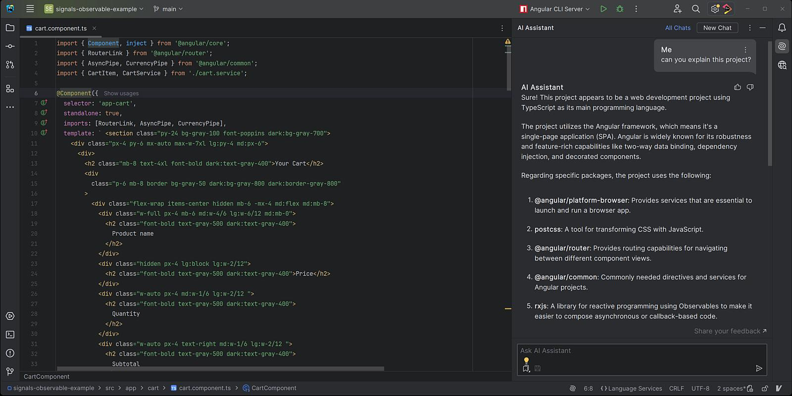
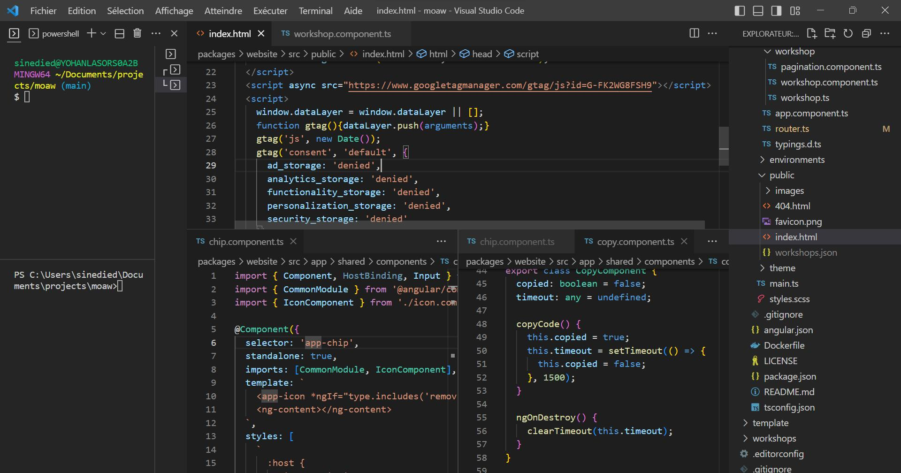
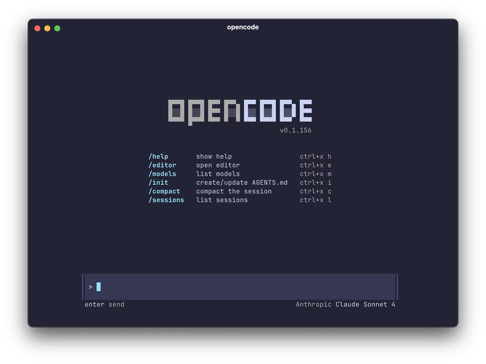

# Development Tools: WebStorm, Visual Studio Code und OpenCode

## Einleitung

Bei der Entwicklung von Frontend-Anwendungen beeinflusst die Wahl der Werkzeuge nicht nur den Komfort einzelner Entwickler. Sie wirkt sich auch auf Teamkonventionen, die Einrichtung der Entwicklungsumgebung, die Versionsverwaltung, Automatisierung und den Einsatz von KI-Werkzeugen aus.

Dieser Artikel vergleicht drei Möglichkeiten für die Arbeit mit TypeScript, Angular und NX:

- **WebStorm** — eine vollwertige integrierte Entwicklungsumgebung (IDE).
- **Visual Studio Code** — ein erweiterbarer Code-Editor.
- **OpenCode** — ein quelloffener AI Coding Agent zur Unterstützung bei der Softwareentwicklung.

Diese Werkzeuge lösen teilweise ähnliche, aber nicht dieselben Aufgaben. WebStorm und Visual Studio Code bilden die primäre Arbeitsumgebung für die Arbeit mit Code. OpenCode konzentriert sich dagegen auf die Interaktion mit einer Codebasis mithilfe eines KI-Agenten. Deshalb sollten die drei Werkzeuge nicht grundsätzlich als direkt austauschbare Alternativen betrachtet werden.

Ziel des Artikels ist es, bei der Auswahl eines geeigneten Entwicklungswerkzeugs zu helfen, ohne einen bestimmten Editor zur Voraussetzung für das Erlernen von NX zu machen.

## 1. WebStorm: Eine vollwertige IDE

WebStorm ist eine integrierte Entwicklungsumgebung von JetBrains mit Schwerpunkt auf JavaScript, TypeScript und modernen Frontend-Technologien.

Im Gegensatz zu einem minimalistischen Editor stellt eine IDE eine abgestimmte Sammlung von Werkzeugen in einer gemeinsamen Arbeitsumgebung bereit. Dazu gehören die Projektnavigation, Codeanalyse, Refactoring, Versionsverwaltung, Run-Konfigurationen und die Integration mit Entwicklungswerkzeugen.

### Vorteile

**Tiefes Verständnis des Projekts.** Die IDE analysiert die Projektstruktur, Beziehungen zwischen Dateien, Importe und Typen. Das erleichtert den Wechsel zu Definitionen, die Suche nach Symbolverwendungen und kontextbezogenes Refactoring.

**Unterstützung für TypeScript und Frontend-Entwicklung.** WebStorm bietet Werkzeuge für JavaScript, TypeScript, HTML, CSS und verwandte Technologien. Für Angular und andere Frontend-Projekte sind insbesondere die Code-Navigation, Typanalyse und Integration mit bekannten Entwicklungswerkzeugen hilfreich.

**Git-Integration.** Änderungen und Diffs prüfen, mit Branches arbeiten und Konflikte lösen — all das ist innerhalb der IDE möglich.

**Eine einheitliche Arbeitsumgebung.** Viele Funktionen stehen direkt zur Verfügung, ohne dass Entwickler selbst eine große Sammlung von Erweiterungen auswählen und abstimmen müssen.

**Unterstützung großer Projekte.** Analyse-, Such- und Refactoring-Werkzeuge können besonders in großen Codebasen nützlich sein, in denen eine einzelne Änderung mehrere Module betreffen kann.

### Einschränkungen

Der wichtigste Nachteil ist das kommerzielle Lizenzmodell. Vor der Entscheidung für WebStorm sollten die aktuellen Lizenzbedingungen und verfügbaren Nutzungsoptionen geprüft werden.

Eine vollwertige IDE kann außerdem erhebliche Systemressourcen beanspruchen. Für kleinere Projekte oder Entwickler, die eine minimalistische Umgebung bevorzugen, sind manche Funktionen möglicherweise überflüssig.

WebStorm macht es auch nicht unnötig, die verwendeten Technologien zu verstehen. Automatisierung erleichtert Navigation und Codeänderungen, ersetzt aber weder Architekturentscheidungen noch die Überprüfung der Ergebnisse.

### Wann ist WebStorm sinnvoll?

WebStorm ist eine gute Option, wenn:

- Sie regelmäßig mit großen TypeScript-Projekten arbeiten.
- Leistungsfähige Navigations- und Refactoring-Funktionen wichtig sind.
- Sie eine integrierte Umgebung mit einem umfangreichen Funktionsumfang bevorzugen.
- Die Lizenzkosten für die private oder geschäftliche Nutzung akzeptabel sind.

Offizielle Website: https://www.jetbrains.com/webstorm/

## 2. Visual Studio Code: Ein erweiterbarer Editor

Visual Studio Code (VS Code) ist ein Code-Editor von Microsoft. Er bietet grundlegende Entwicklungsfunktionen, die sich durch Erweiterungen ergänzen lassen.

VS Code wird häufig wegen seiner Flexibilität, Zugänglichkeit und der Möglichkeit gewählt, die Arbeitsumgebung an ein konkretes Projekt anzupassen.

### Vorteile

**Zugänglichkeit.** VS Code wird kostenlos angeboten. Die Nutzungsbedingungen des Editors selbst sollten jedoch getrennt von den Bedingungen einzelner Erweiterungen oder angebundener Dienste betrachtet werden.

**Erweiterbarkeit.** Funktionen lassen sich schrittweise hinzufügen, beispielsweise Angular-Unterstützung, zusätzliche TypeScript-Werkzeuge, Git-Integration, Formatierung, Lint-Prüfungen und Werkzeuge für AI-assisted Development.

**Terminal-Integration.** Über das integrierte Terminal lassen sich npm-, NX-CLI-, Git- und andere Befehle ausführen, ohne ständig zwischen Anwendungen wechseln zu müssen.

**Flexible Konfiguration.** Ein Team kann sich auf Erweiterungen, Formatierungseinstellungen, Editor-Regeln und weitere projektspezifische Einstellungen verständigen.

**Weite Verbreitung.** Viele Frontend-Entwickler kennen VS Code bereits. Dadurch ist er oft eine praktische Option für Teams mit unterschiedlichen Erfahrungen und Präferenzen.

### Einschränkungen

Die Flexibilität hat auch eine Kehrseite: Die Arbeitsumgebung muss konfiguriert und gepflegt werden.

Wenn Entwickler unterschiedliche Erweiterungen und Einstellungen verwenden, können sich Formatierung, Diagnose und Automatisierung unterscheiden. Nicht jede Erweiterung wird gleich gut gepflegt, und eine große Anzahl von Ergänzungen kann die Fehlersuche erschweren.

Eine Erweiterung garantiert außerdem weder, dass alle ihre Funktionen kostenlos sind, noch dass ein angebundener Dienst in jeder Region oder jedem Unternehmensnetzwerk verfügbar ist.

### Wann ist Visual Studio Code sinnvoll?

VS Code ist eine gute Option, wenn:

- Sie einen kostenlosen Editor mit umfangreichen Möglichkeiten benötigen.
- Sie Ihre Entwicklungsumgebung selbst zusammenstellen möchten.
- Ihr Team Kommandozeilenwerkzeuge und Projektkonfigurationen verwendet.
- Der Editor in bestehende Entwicklungsprozesse eingebunden werden soll.
- Sie KI-Werkzeuge unabhängig von Ihrer primären Entwicklungsumgebung auswählen möchten.

Offizielle Website: https://code.visualstudio.com/

## 3. OpenCode: Ein KI-Agent für die Arbeit mit Code

OpenCode ist ein quelloffener AI Coding Agent, der bei Aufgaben der Softwareentwicklung unterstützt.

Seine Hauptrolle unterscheidet sich von der eines klassischen Editors oder einer IDE. Ein KI-Agent bietet nicht nur eine Oberfläche für die manuelle Bearbeitung von Dateien, sondern kann den Projektkontext analysieren, bei der Strukturierung einer Aufgabe helfen, Änderungen vorschlagen und erlaubte Aktionen innerhalb seines Workflows ausführen.

OpenCode kann über ein Terminal, eine eigenständige Anwendung oder Integrationen mit Editoren und IDEs verwendet werden. Welche Arbeitsweisen verfügbar sind, hängt von der aktuellen Version des Werkzeugs ab.

### Vorteile

**Aufgabenkontext.** Der Agent kann bestehende Codebereiche untersuchen, die Projektstruktur erklären, einen Änderungsplan vorschlagen oder die Umsetzung einer bestimmten Funktion vorbereiten.

**Unterstützung bei wiederkehrenden Aufgaben.** Ein KI-Agent kann beim Schreiben von Tests, bei der Dokumentation, der Fehlersuche und bei gezieltem Refactoring helfen.

**Integration in die bestehende Umgebung.** OpenCode muss den primären Editor nicht ersetzen. Er kann als zusätzliches Werkzeug in einem bestehenden Entwicklungsprozess eingesetzt werden.

**Quelloffenheit.** Die Möglichkeit, den Quellcode des Werkzeugs einzusehen und zu prüfen, kann bei der technischen Bewertung und der Entscheidung über die Nutzung wichtig sein.

**Flexibilität bei der KI-Infrastruktur.** Die Anbindung von Modellen und Anbietern hängt von der aktuellen Konfiguration und den unterstützten Integrationen ab. Vor der Nutzung sollten verfügbare Optionen, Kosten und Einschränkungen geprüft werden.

### Einschränkungen

OpenCode sollte nicht automatisch als vollständiger Ersatz für eine IDE betrachtet werden. Manuelle Navigation, visuelle Bearbeitung, Debugging und andere gewohnte Arbeitsweisen hängen davon ab, mit welchem Editor oder welcher Anwendung das Werkzeug eingesetzt wird.

**Quelloffenheit bedeutet nicht, dass alle KI-Funktionen kostenlos sind.** Der Zugriff auf Modelle kann einen kostenpflichtigen Anbieter oder eine eigene Infrastruktur erfordern.

Die Verfügbarkeit bestimmter Modelle und Anbieter kann von der Region, Netzwerkbeschränkungen und Unternehmensrichtlinien abhängen.

Ein KI-Agent kann außerdem eine falsche Lösung vorschlagen, ungeeignete Dateien ändern oder Anforderungen missverstehen. Generierter Code muss überprüft werden. Änderungen sollten mithilfe von Diffs, Tests und weiteren Qualitätsprüfungen kontrolliert werden.

Bei der Arbeit mit Unternehmens-Repositories sind Sicherheitsregeln wichtig: Welche Daten dürfen an externe Dienste übertragen werden? Welche Werkzeuge dürfen Befehle ausführen? Für welche Aktionen ist eine Bestätigung durch den Entwickler erforderlich?

### Wann ist OpenCode sinnvoll?

OpenCode ist eine Option, wenn:

- Sie AI-assisted Development praktisch kennenlernen möchten.
- Sie einem Agenten begrenzte Aufgaben zur Codeanalyse oder Codeänderung übertragen wollen.
- Sie einen KI-Agenten unabhängig von einem bestimmten Editor einsetzen möchten.
- Ihr Team die Ergebnisse des Agenten prüfen und seine Berechtigungen kontrollieren kann.
- Sie alternative Möglichkeiten zur Integration von KI in den Entwicklungsprozess bewerten möchten.

Offizielle Website: https://opencode.ai/

## 4. Vergleich der Werkzeuge

| Kriterium | WebStorm | Visual Studio Code | OpenCode |
|---|---|---|---|
| Hauptzweck | Vollwertige IDE | Erweiterbarer Editor | AI Coding Agent |
| Nutzungsmodell | Integrierte Umgebung | Editor mit Erweiterungen | Agentenbasierter Workflow |
| TypeScript-Arbeit | Integrierte IDE-Werkzeuge | Grundfunktionen und Erweiterungen | KI-gestützte Codeanalyse und -änderung |
| Git-Integration | Integrierte Oberfläche | Editor- und Erweiterungsintegration | Abhängig vom Workflow und den verfügbaren Werkzeugen |
| Terminalbefehle | Unterstützt | Integriertes Terminal | Eine der zentralen Interaktionsmöglichkeiten |
| Konfiguration | Viele Funktionen integriert | Sehr flexibel | Abhängig von Konfiguration und angebundenen Anbietern |
| Lizenzierung und Kosten | Kommerzielle Lizenz; aktuelle Bedingungen prüfen | Editor kostenlos; einzelne Dienste können eigene Bedingungen haben | Quelloffenes Werkzeug; Modellnutzung kann Kosten verursachen |
| Wichtigster Kompromiss | Kosten und Ressourcenverbrauch | Auswahl und Pflege der Arbeitsumgebung | Ergebnisse des Agenten müssen überprüft werden |

Die Tabelle zeigt, dass sich die Werkzeuge vor allem durch ihre jeweilige Rolle unterscheiden. WebStorm und VS Code dienen als primäre Arbeitsumgebung für ein Projekt. OpenCode ergänzt den Entwicklungsprozess um eine KI-gestützte Möglichkeit, technische Aufgaben zu bearbeiten.

In manchen Szenarien konkurrieren die Werkzeuge daher nicht direkt miteinander: Ein Entwickler kann VS Code oder WebStorm zusammen mit OpenCode verwenden.

## 5. Welche Werkzeuge passen zu NX und Angular?

Bei der Arbeit mit NX ist es wichtig, Werkzeuge zur Codebearbeitung von den Werkzeugen des Projekts selbst zu unterscheiden.

NX stellt ein eigenes System zur Verwaltung von Workspaces und Aufgaben bereit. Befehle zum Starten, Bauen, Testen und für weitere Operationen werden über die NX CLI und die Projektkonfiguration ausgeführt. Diese Mechanismen sind nicht exklusiv an WebStorm oder VS Code gebunden.

Ein Entwickler kann beispielsweise denselben NX-Workspace in unterschiedlichen Editoren öffnen, Befehle über ein Terminal ausführen und Änderungen mit Git verwalten. Die Integration kann sich im Komfort unterscheiden, aber die Architektur des Workspaces sollte nicht von der bevorzugten IDE abhängen.

Ein möglicher Ausgangspunkt:

- **WebStorm** — wenn eine vollwertige IDE mit leistungsfähiger Navigation und Refactoring gefragt ist.
- **Visual Studio Code** — wenn Zugänglichkeit, flexible Konfiguration und eine erweiterbare Umgebung wichtig sind.
- **OpenCode** — wenn der bestehende Entwicklungsprozess durch einen KI-Agenten ergänzt werden soll.

Wer gerade erst mit NX beginnt, sollte zunächst die grundlegenden Befehle und die Workspace-Struktur kennenlernen. So lässt sich nachvollziehen, was beim Ausführen einer Aufgabe geschieht — unabhängig vom verwendeten Editor.

Ein KI-Agent kann bei der Untersuchung der NX-Konfiguration oder bei der Vorbereitung von Änderungen helfen. Seine Vorschläge sollten jedoch genauso geprüft werden wie Änderungen, die von Menschen vorgeschlagen wurden.

## 6. Praktische Empfehlungen für Teams

Die Wahl des Editors ist eine individuelle Entscheidung, die Zusammenarbeit im Team erfordert jedoch gemeinsame Regeln.

### Vereinbart Qualitätsstandards für Code

Formatierung, Lint-Prüfungen, Tests und Builds sollten sich vor allem auf die Projektkonfiguration und automatisierte Prüfungen stützen, nicht auf persönliche Einstellungen einzelner Entwickler.

### Bindet die Dokumentation nicht an einen bestimmten Editor

Wenn das Team NX CLI und standardisierte Projektbefehle verwendet, bleiben die Anleitungen auch für Entwickler mit anderen Werkzeugen gültig.

### Kontrolliert Änderungen

Verwendet Git, prüft Diffs und führt die im Projekt vorgesehenen Prüfungen aus. Das ist besonders wichtig beim Einsatz von KI-Agenten, die im Rahmen einer Aufgabe mehrere Dateien ändern können.

### Definiert Regeln für den KI-Einsatz

Vor der Anbindung von KI-Werkzeugen sollten Anforderungen an Vertraulichkeit, Zugriff auf Quellcode, Ausführung von Befehlen und Prüfung der Ergebnisse vereinbart werden.

### Wählt Werkzeuge passend zur Aufgabe

Es ist nicht notwendig, alle Entwickler zur Verwendung desselben Editors zu verpflichten, solange Unterschiede die Zusammenarbeit nicht beeinträchtigen. Einheitliche Projektregeln, reproduzierbare Befehle und überprüfbare Qualität sind deutlich wichtiger.

## Fazit

WebStorm, Visual Studio Code und OpenCode stehen für unterschiedliche Ansätze in der Softwareentwicklung.

WebStorm bietet eine integrierte IDE, Visual Studio Code eine flexible und erweiterbare Umgebung und OpenCode einen KI-Agenten zur Unterstützung technischer Aufgaben mithilfe von Modellen.

Einen universellen Gewinner gibt es nicht. Die Wahl hängt von den Aufgaben, dem Budget, den Vorlieben der Entwickler, unternehmensinternen Einschränkungen und den Anforderungen an KI-Werkzeuge ab.

Für den Enterprise Frontend Workshop bleibt das zentrale Prinzip unverändert: **Technische Anleitungen sollen erklären, wie das Projekt funktioniert, und keinen bestimmten Editor voraussetzen.**

Wer NX CLI, die Workspace-Struktur, die Aufgabenkonfiguration und grundlegende Git-Praktiken beherrscht, kann dieses Wissen in der bevorzugten Arbeitsumgebung anwenden.

### Offizielle Dokumentation

- [WebStorm](https://www.jetbrains.com/webstorm/)
- [WebStorm-Dokumentation](https://www.jetbrains.com/help/webstorm/)
- [Visual Studio Code](https://code.visualstudio.com/)
- [Visual Studio Code-Dokumentation](https://code.visualstudio.com/docs)
- [OpenCode](https://opencode.ai/)
- [NX-Dokumentation](https://nx.dev/)
